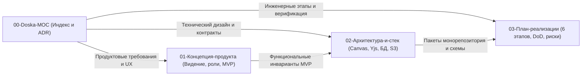

# Doska — Карта документации проекта (MOC)

Навигация: **Карта проекта (MOC)** | [[01-Концепция-продукта]] | [[02-Архитектура-и-стек]] | [[03-План-реализации]]

---

## 1. Резюме продукта и ключевая ценность

**Doska** — командная интерактивная веб-доска с бесконечным холстом, совместной работой в реальном времени, командными воркспейсами и мгновенным доступом по ссылке. Продукт создаётся как быстрый, визуально чистый и отзывчивый инструмент совместного мышления для инженерных, продуктовых и дизайн-команд.

Ключевая ценность **Doska** строится на четырёх опорах:

1. **Мгновенный отклик на уровне нативного приложения**: холодное открытие ранее посещённых досок из локального кеша браузера без ожидания сети и стабильные `60 FPS` при навигации и редактировании сцен объёмом `5 000+` объектов.
2. **Нулевой барьер для совместной работы**: отправка одной ссылки с уровнем доступа `view`, `comment` или `edit` позволяет коллеге или внешнему гостю подключиться к холсту за долю секунды — с временным именем и живым курсором без принудительной регистрации.
3. **Бесконфликтный мультиплеер в реальном времени (CRDT)**: участники одновременно двигают стикеры, перестраивают архитектурные схемы, рисуют от руки и ведут за собой группу в режиме `Follow mode`, а данные детерминированно сходятся к единому состоянию даже после обрыва связи.
4. **Фокус на холсте вместо визуального шума**: интерфейс не перегружен второстепенными корпоративными надстройками; все базовые примитивы (стикеры, фигуры, умные коннекторы, фреймы, перо, изображения и комментарии) управляются через лаконичный тулбар и продуманную систему горячих клавиш.

---

## 2. Карта навигации по документам

Комплект проектной документации состоит из индексной карты [[00-Doska-MOC]] и трёх профильных спецификаций, связанных единой доменной моделью и сквозными архитектурными контрактами:

| Документ | Назначение | Ключевые темы внутри раздела |
| :--- | :--- | :--- |
| [[00-Doska-MOC]] | Точка входа и реестр архитектурных решений | Резюме ценности продукта, карта связей документации, сводка ключевых решений `ADR-01` … `ADR-08` |
| [[01-Концепция-продукта]] | Продуктовая спецификация и пользовательский опыт | Видение и отстройка от тяжёлых комбайнов, персоны и 4 сквозных сценария работы, модель воркспейсов и ролей (`Owner`..`Viewer`), механика ссылок и гостевого входа, детальный состав MVP и вектор развития `v1.1` / `v2.0` |
| [[02-Архитектура-и-стек]] | Системная архитектура, контракты данных и стек | Монорепозиторий `pnpm` + `Turborepo`, движок `Canvas 2D` + `rbush` + `LOD` + HTML-оверлей, CRDT-модель `Yjs` + `fractional-indexing` + `Awareness`, TypeScript-интерфейсы сцены, схема `PostgreSQL` и `S3`, безопасность и целевые метрики производительности |
| [[03-План-реализации]] | Инженерная декомпозиция, риски и стратегия качества | План разработки из 6 последовательных этапов с входными зависимостями и `Definition of Done`, граф подсистем, реестр технических рисков с мерами защиты, многоуровневая стратегия тестирования |

---

## 3. Сводка ключевых архитектурных и продуктовых решений (ADR-01 … ADR-08)

Ниже зафиксированы базовые продуктово-инженерные решения системы (подробное обоснование и контракты раскрыты в [[02-Архитектура-и-стек]], пользовательская механика — в [[01-Концепция-продукта]], а порядок реализации — в [[03-План-реализации]]).

### ADR-01. Web SaaS на базе `Next.js` (App Router) в монорепозитории `pnpm` + `Turborepo`

- **Решение**: развивать продукт как Web-first SaaS на `Next.js` (App Router), `React`, `TypeScript`, `Tailwind CSS`, `shadcn/ui` и `Lucide` внутри монорепозитория `pnpm` + `Turborepo` с разделением на `apps/web`, `apps/sync-server` и пакеты `packages/canvas-core`, `packages/collaboration`, `packages/shared`, `packages/db`.
- **Обоснование**: основной канал органического роста доски — мгновенное открытие ссылки в браузере без установки клиента. Выделение платформонезависимого ядра холста и схем данных позволяет переиспользовать код между фронтендом и WebSocket-сервером, а на этапе `v1.1` / `v2.0` обернуть клиент в нативное десктопное приложение на `Tauri`.

### ADR-02. Гибридный движок `HTML5 Canvas 2D` + `rbush` + HTML-оверлей (с абстракцией под `WebGL` / `PixiJS`)

- **Решение**: рендерить сцену императивно в `HTML5 Canvas 2D` за интерфейсом `IRenderBackend` (допускающим подключение `WebGL` / `PixiJS`), использовать пространственное R-tree дерево `rbush` для `viewport culling` и `hit-testing`, применять уровни детализации (`LOD`) при отдалении камеры и монтировать поверх холста тонкий HTML-оверлей для ввода текста и контролов трансформации.
- **Обоснование**: DOM/SVG-подход деградирует при панорамировании уже на `1 000–2 000` узлах из-за пересчёта layout и стилей браузера. Связка `Canvas 2D` + выборка видимой области из `rbush` за `O(log N + K)` удерживает `60 FPS` на `5 000+` объектах, а нативный HTML-редактор текста сохраняет системную поддержку IME, орфографии, буфера обмена и выделения без переизобретения текстовой вёрстки на холсте.

### ADR-03. CRDT-модель сцены на `Yjs` (`Y.Map`) и бесконфликтный порядок слоёв через `fractional-indexing`

- **Решение**: представить граф элементов доски в `Y.Doc` как `Y.Map<string, Y.Map<unknown>>` (каждый объект — вложенная карта атрибутов), хранить порядок наложения слоёв в виде лексикографического строкового ключа `zIndexKey` (`fractional-indexing`), а локальную историю отмен изолировать через `Y.UndoManager` с фильтрацией по `trackedOrigins`.
- **Обоснование**: поатрибутный `Y.Map` позволяет двум участникам одновременно менять координаты и стиль одного объекта без перезаписи чужих изменений. Дробное индексирование сводит операции `Bring to Front` / `Send Backward` к обновлению одного строкового поля целевой фигуры без переиндексации общего массива, а фильтрация `origin` гарантирует, что `Cmd/Ctrl + Z` отменяет только действия самого пользователя.

### ADR-04. Протокол `Awareness` для живых курсоров, чужого выделения и `Follow mode`

- **Решение**: полностью отделить эфемерное состояние присутствия участников (мировые координаты курсора, массив выделенных элементов `selectedIds`, идентификатор редактируемого текстового блока `editingElementId`, параметры камеры `viewport` для `Follow mode`) от персистентного `Y.Doc`, транслируя его через легковесный канал `Yjs Awareness` с троттлингом отправки и клиентской интерполяцией.
- **Обоснование**: координаты указателя мыши обновляются с частотой `30–60 Гц`. Передача их через основной CRDT-документ привела бы к взрывному росту бинарной истории и нагрузки на хранилище. В `Awareness` эти пакеты не сохраняются на диск и автоматически очищаются при разрыве соединения (включая мгновенное снятие мягкой блокировки текста `Soft Text Lock`).

### ADR-05. Локальный буфер `IndexedDB` (`y-indexeddb`) и устойчивость к обрывам сети

- **Решение**: сохранять состояние и инкрементальные обновления открытых досок в браузерной БД `IndexedDB` через адаптер `y-indexeddb`, выполняя первичную отрисовку холста из локального кеша параллельно с установкой `WebSocket`-сессии.
- **Обоснование**: повторное открытие рабочей доски занимает десятки миллисекунд независимо от задержки сети, а при кратковременном пропадании связи пользователь продолжает редактировать холст без блокирующих модальных окон — накопленная бинарная дельта автоматически синхронизируется по `state vector` при переподключении.

### ADR-06. Разделение хранилищ: бинарные снапшоты и медиа в `S3`, метаданные и ACL в `PostgreSQL`

- **Решение**: хранить учётные записи, воркспейсы, проекты, ролевую матрицу `RBAC`, публичные ссылки доступа, реестр снапшотов и координатные треды комментариев в `PostgreSQL`, а бинарные дампы `Y.Doc`, превью досок и загруженные изображения — в S3-совместимом объектном хранилище.
- **Обоснование**: реляционная СУБД идеально решает задачи строгой проверки прав доступа, фильтрации каталога досок и текстовых обсуждений без прокачки тяжёлых бинарных блобов через буферный пул БД, тогда как `S3` обеспечивает дешёвое, версионируемое и горизонтально масштабируемое хранение слепков сцен и статики.

### ADR-07. Кластер `WebSocket`-шлюзов с координацией через `Redis Pub/Sub` и фоновой компактификацией

- **Решение**: выделить синхронизацию реального времени в отдельный stateful-сервис `apps/sync-server`, синхронизирующий инстансы по комнатам `boardId` через `Redis Pub/Sub` и периодически выполняющий компактификацию (`Y.encodeStateAsUpdate`) накопленных CRDT-апдейтов в единый снапшот в `S3`.
- **Обоснование**: изоляция долгоживущих `WebSocket`-соединений от stateless HTTP-обработчиков `Next.js` позволяет независимо масштабировать слой реального времени, а регулярная сборка мусора и слияние мелких дельт поддерживают быстрое холодное открытие старых досок с богатой историей правок.

### ADR-08. Безопасность шеринга: `Effective Role`, короткоживущие `JWT` для `WebSocket` и `pre-signed URLs`

- **Решение**: вычислять результирующую роль сессии (`Owner`, `Admin`, `Editor`, `Commenter`, `Viewer`) на бэкенде с учётом членства в воркспейсе и токена ссылки доступа (включая мгновенный гостевой вход с подписанным `guestId`), выдавать короткоживущий `JWT` специально для рукопожатия `WebSocket` с жёстким запретом записи на сокете для `Viewer`/`Commenter`, а загрузку и чтение медиафайлов вести напрямую с `S3` по `pre-signed URLs`.
- **Обоснование**: проверка прав только на клиенте уязвима к модификации кадров WebSocket; принудительная фильтрация входящих `Yjs`-сообщений на уровне `sync-server` гарантирует целостность доски при публичном шеринге, а прямая загрузка ассетов в `S3` разгружает прикладные серверы от проксирования мультимедийного трафика.

---

## 4. Быстрые переходы по ключевым артефактам

- Персоны, пользовательские сценарии, ролевая матрица и гостевой вход по ссылке: [[01-Концепция-продукта]] (разделы 2 и 3).
- Спецификация бесконечного холста, примитивов и синхронного мультиплеера MVP: [[01-Концепция-продукта]] (раздел 4).
- Устройство рендерера, TypeScript-интерфейсы элементов сцены и DDL-схема `PostgreSQL`: [[02-Архитектура-и-стек]] (разделы 2, 4 и 5).
- Декомпозиция на 6 инженерных этапов, `Definition of Done`, риски и тестирование: [[03-План-реализации]] (разделы 1–4).
