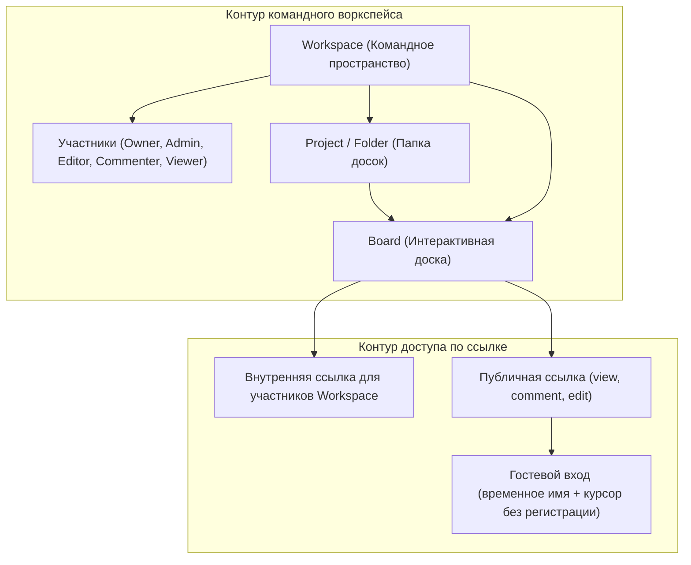

# Концепция продукта Doska

Навигация: [[00-Doska-MOC]] | **Концепция продукта** | [[02-Архитектура-и-стек]] | [[03-План-реализации]]

---

## 1. Видение продукта и решаемые проблемы

### 1.1. Боли распределённых и гибридных команд

В распределённых инженерных и продуктовых командах физическая маркерная доска уступила место облачным визуальным пространствам. Однако по мере обрастания корпоративными модулями существующие онлайн-доски создали четыре заметных препятствия для ежедневной командной работы:

1. **Высокая задержка открытия и деградация отклика на рабочих досках**: перегруженные клиентские бандлы долго инициализируются, а холсты после нескольких сессий проектирования или планирования начинают терять плавность при панорамировании и масштабировании. Задержка отклика курсора разрушает динамику живого обсуждения.
2. **Трение при шеринге по ссылке и гостевом входе**: подключение коллеги из соседнего подразделения, внешнего эксперта, клиента или кандидата на архитектурном собеседовании часто упирается в обязательную регистрацию, подтверждение почты и ограничения тарификации гостевых лицензий.
3. **Визуальный шум и когнитивная перегрузка**: десятки панелей, встроенных витрин плагинов, всплывающих подсказок и сложных меню сужают полезную площадь экрана и мешают сфокусироваться на содержании схемы.
4. **Хрупкость при нестабильном соединении**: кратковременная потеря сети или переключение VPN в большинстве веб-инструментов блокирует работу с доской модальным экраном переподключения, обрывая мысль участника.

### 1.2. Видение и продуктовые принципы Doska

**Doska** — командная интерактивная веб-доска, построенная вокруг ощущения мгновенного, прямого манипулирования идеями и схемами на бесконечном холсте (сводка ключевых решений приведена в [[00-Doska-MOC]]).

Четыре продуктовых принципа **Doska**:

- **Мгновенный отклик как базовое свойство**: открытие доски из локального кеша без ожидания сети, стабильные `60 FPS` при навигации и редактировании сцен на `5 000+` объектов, предсказуемая геометрия фигур и связей (технический дизайн раскрыт в [[02-Архитектура-и-стек]]).
- **Шеринг в одно действие**: прямая ссылка с правом `view`, `comment` или `edit` позволяет внешнему участнику оказаться на доске мгновенно — с автоматически выданным или введённым временным именем и живым курсором без регистрации.
- **Чистый интерфейс вокруг холста**: максимум пространства отведено рабочей поверхности; компактный тулбар инструментов, контекстное меню свойств над выделенным объектом и продуманные однобуквенные горячие клавиши обеспечивают высокую скорость работы.
- **Бесконфликтная совместная работа и устойчивость к офлайну**: архитектура на базе CRDT и локального буфера позволяет десяткам участников параллельно редактировать общую схему без взаимных перезаписей и продолжать работу при кратковременных разрывах связи.

| Критерий сравнения | Перегруженные корпоративные комбайны | Локальные редакторы диаграмм | Doska |
| :--- | :--- | :--- | :--- |
| Скорость открытия и плавность холста | Долгий холодный старт, просадки FPS на крупных досках | Высокая, но только в рамках локального файла | Мгновенный старт из локального кеша, `60 FPS` на `5 000+` элементах |
| Совместная работа в реальном времени | Есть, но высокий барьер для внешних участников | Отсутствует либо через ручной обмен файлами | Нативный CRDT-мультиплеер, живые курсоры, `Follow mode` |
| Вход по ссылке без регистрации | Часто заблокирован или требует создания аккаунта | Неприменимо | Мгновенный гостевой вход с временным именем (`view`, `comment`, `edit`) |
| Чистота интерфейса и порог входа | Перегруженные боковые панели и лишние модули | Узкоспециализированный технический интерфейс | Лаконичный тулбар, быстрые примитивы и интуитивные хоткеи |

---

## 2. Целевые персоны и пользовательские сценарии

### 2.1. Целевые персоны

1. **Продуктовый менеджер / Фасилитатор (Анна)**: организует дискавери-сессии, брейнштормы, разборы метрик, построение CJM и межкомандное планирование. Ей критичны быстрая работа со стикерами и фреймами, удержание внимания группы через `Follow mode`, готовые шаблоны и чистый экспорт результатов в `PDF` / `PNG`.
2. **Системный архитектор / Tech Lead (Дмитрий)**: проектирует архитектуру сервисов, схемы данных, диаграммы последовательностей и событийные потоки прямо на созвоне с инженерами. Ценит точные магнитные порты фигур, предсказуемые ортогональные коннекторы, сетку с привязкой, горячие клавиши и точечные пин-комментарии на узлах схемы.
3. **Продуктовый дизайнер (Мария)**: выкладывает серии экранов интерфейса, собирает пользовательские потоки (`User Flows`), отмечает развилки состояний и собирает асинхронные комментарии от команды разработки и бизнеса.
4. **Инженер разработки / Участник команды (Илья)**: переходит по ссылке из рабочего мессенджера на стендапе, ретроспективе или разборе инцидента. Ожидает нулевого порога входа: открыть ссылку, сразу увидеть рассказчика, добавить несколько карточек или стрелок и оставить комментарий.
5. **Внешний гость / Стейкхолдер (Сергей)**: заказчик, партнёр из внешнего агентства или кандидат на техническом интервью, подключающийся по публичной ссылке без аккаунта в корпоративном воркспейсе.

### 2.2. Развёрнутые пользовательские сценарии

#### Сценарий 1. Брейншторминг на стикерах в реальном времени

- **Контекст**: кросс-функциональная команда из 10 человек ищет точки роста активации новых пользователей.
- **Поток взаимодействия**:
  1. Фасилитатор создаёт новую доску в папке продукта, размещает три фрейма («Наблюдения и боли», «Гипотезы», «Приоритетные эксперименты») и отправляет в чат созвона ссылку с уровнем доступа `edit`.
  2. Члены воркспейса входят под своими учётными записями, а приглашённый внешний исследователь открывает ту же ссылку без регистрации, вписывает в шапке имя `Сергей` и сразу появляется на холсте со своим цветным курсором.
  3. Участники нажимают клавишу `S`, ставят стикер, вводят идею и нажатием `Tab` мгновенно создают соседний стикер того же цвета; кегль шрифта автоматически подстраивается под объём текста карточки.
  4. На этапе синтеза фасилитатор активирует действие «Позвать всех ко мне» (`Follow mode`), чтобы сфокусировать экраны всех участников на первом фрейме, после чего команда совместно группирует стикеры в смысловые кластеры и обводит ключевые группы маркером.

#### Сценарий 2. Проектирование системной архитектуры и инженерных схем

- **Контекст**: архитектор и бэкенд-разработчики проектируют контур биллинга, контракты брокера сообщений и схему отказоустойчивости.
- **Поток взаимодействия**:
  1. Архитектор включает адаптивную сетку и режим `snap-to-grid`, создаёт контурные фреймы подсистем (`Ingress`, `Core Services`, `Event Bus`, `Data Stores`).
  2. С помощью горячих клавиш (`R` — прямоугольник сервиса, `O` — узел события, фигура цилиндра — БД и объектное хранилище) инженеры параллельно размещают узлы архитектуры, выравнивая их по динамическим направляющим (`Smart Guides`).
  3. Клавишей `C` выбирается инструмент коннектора: при наведении на грань блока подсвечиваются магнитные порты (`top`, `right`, `bottom`, `left`), от которых протягиваются ортогональные и изогнутые стрелки с текстовыми подписями протоколов (`gRPC`, `Kafka: billing.events`).
  4. При перемещении блока сервиса в другое место фрейма все привязанные к нему коннекторы автоматически перестраивают ортогональные сегменты без разрыва связей.
  5. Инженер информационной безопасности открывает доску по ссылке с правом `comment`, ставит пин-комментарий на коннектор внешнего API с замечанием по аутентификации; после внесения правок автор схемы помечает тред статусом `Resolved`.

#### Сценарий 3. Ретроспективы и квартальное планирование

- **Контекст**: продуктовое направление подводит итоги цикла разработки и формирует согласованную карту целей, функциональных эпиков и межкомандных зависимостей на следующий квартальный горизонт.
- **Поток взаимодействия**:
  1. Ведущий создаёт доску из встроенного шаблона ретроспективы (`Start / Stop / Continue / Action Items`) и размещает рядом фрейм матрицы квартального планирования (строки — продуктовые команды, колонки — целевые этапы и инициативы).
  2. Участники параллельно наполняют колонки стикерами наблюдений и карточками задач; если два человека одновременно обращаются к одной карточке, рамка чужого выделения с бейджем имени и мягкая блокировка редактируемого текста предотвращают случайное наложение правок.
  3. Зависимости между эпиками смежных команд соединяются контрастными пунктирными коннекторами со стрелками, наглядно выявляя узкие места плана.
  4. Согласованный фрейм с планом и списком `Action Items` экспортируется в векторный `PDF` и `PNG` высокого разрешения для фиксации в корпоративной документации.

#### Сценарий 4. Продуктовые CJM и пользовательские потоки (User Flows)

- **Контекст**: продакт-менеджер и дизайнер собирают сквозную карту клиентского пути (`Customer Journey Map`) от первого касания до целевого действия с привязкой актуальных макетов экранов.
- **Поток взаимодействия**:
  1. Дизайнер перетаскивает из файловой системы или вставляет из буфера обмена серию `PNG`/`WebP` экранов прямо на холст; изображения мгновенно рендерятся из локального буфера и в фоне загружаются в хранилище.
  2. Экраны выстраиваются в последовательность, ромбами задаются точки ветвления логики (успех, пустое состояние, ошибка валидации), а кривыми коннекторами показываются переходы пользователя между состояниями.
  3. Под каждым этапом размещаются строки стикеров: действия пользователя, эмоции/ожидания, болевые точки и продуктовые возможности.
  4. Каждый этап CJM оборачивается в пронумерованный фрейм формата `16:9`. На продуктовом ревью ведущий запускает полноэкранный **режим презентации**, плавно перемещая камеру от фрейма к фрейму клавишами со стрелками.

---

## 3. Модель воркспейсов, папок/проектов, ролей и шеринга по ссылке

### 3.1. Иерархия организации контента

Пространство данных **Doska** организовано в три понятных уровня (схема хранения в БД описана в [[02-Архитектура-и-стек]]):

1. **Workspace (Воркспейс)**: изолированное командное или личное пространство. Содержит список участников, базовые роли, каталог проектов и настройки безопасности публичных ссылок.
2. **Project / Folder (Папка / Проект)**: именованный раздел внутри воркспейса для структурной группировки досок по продуктам, командам или рабочим потокам. Доска может лежать как внутри папки/проекта, так и в корне воркспейса.
3. **Board (Доска)**: единица совместной работы — бесконечный холст со своим CRDT-состоянием, медиа-ассетами, ветками комментариев, историей снапшотов и правилами доступа.

### 3.2. Матрица ролей (`RBAC`)

В системе действуют пять канонических ролей, которые назначаются участникам воркспейса и могут уточняться на уровне конкретной доски:

| Операция / Разрешение | `Owner` | `Admin` | `Editor` | `Commenter` | `Viewer` |
| :--- | :---: | :---: | :---: | :---: | :---: |
| Удаление воркспейса и передача прав `Owner` | Да | Нет | Нет | Нет | Нет |
| Управление участниками воркспейса, ролями и политиками внешнего шеринга | Да | Да | Нет | Нет | Нет |
| Создание, переименование и удаление любых папок/проектов и досок воркспейса | Да | Да | Свои объекты | Нет | Нет |
| Создание новых досок, дублирование и редактирование содержимого холста | Да | Да | Да | Нет | Нет |
| Загрузка изображений на холст и управление настройками фреймов | Да | Да | Да | Нет | Нет |
| Создание, настройка и отзыв публичных ссылок доступа (`view`, `comment`, `edit`) | Да | Да | Да | Нет | Нет |
| Постановка пинов комментариев, ответы в тредах и смена статуса `Resolve` | Да | Да | Да | Да | Нет |
| Просмотр доски, панорамирование, поиск текста, `Follow mode`, экспорт | Да | Да | Да | Да | Да |
| Отображение живого курсора и присутствия в списке активных участников | Да | Да | Да | Да | Да |

### 3.3. Механика ссылок доступа (`view`, `comment`, `edit`) и гостевой вход

Для каждой доски поддерживаются гибкие сценарии предоставления доступа:

- **Доступ внутри воркспейса**: по умолчанию определяет, могут ли остальные участники этого же `Workspace` открыть доску по прямой ссылке (`нет доступа`, `view`, `comment`, `edit`) без ручного добавления каждого человека.
- **Публичные ссылки доступа (`Board Share Links`)**: выпускаются с криптографически случайным токеном в URL и одним из трёх уровней прав:
  - `view` — только чтение, навигация, поиск и участие в `Follow mode` (с отображением присутствия);
  - `comment` — права `view` плюс создание пин-комментариев и участие в тредах обсуждений;
  - `edit` — полноценное соавторство на холсте (создание и трансформация всех примитивов, загрузка изображений, рисование) без права удаления самой доски или изменения настроек воркспейса.
- **Дополнительная защита ссылок**: опциональный срок истечения (`expiresAt`), опциональный парольный хеш на вход по ссылке и мгновенный отзыв токена с принудительным закрытием или понижением прав активных WebSocket-подключений.
- **Алгоритм разрешения прав**: итоговая роль пользователя на доске вычисляется как `effectiveRole = max(workspaceRole, explicitBoardRole, validShareLinkRole)`, ограниченная сверху глобальной политикой безопасности воркспейса (например, запретом внешних `edit`-ссылок на уровне организации).

**Мгновенный гостевой вход с временным именем**:

1. Посетитель без аккаунта переходит по валидной публичной ссылке.
2. Приложение **не показывает принудительную форму регистрации или логина** — холст загружается сразу.
3. Сервер выписывает гостю подписанную сессионную куку (`guestId`), чтобы при обновлении страницы за ним сохранялись выбранное имя, цвет присутствия, авторство комментариев и локальная история отмен.
4. По умолчанию гостю назначается дружелюбный временный псевдоним (например, `Гость Сокол`) и свободный акцентный цвет из палитры присутствия, а в верхней панели открывается компактный инлайн-инпут для ввода собственного имени (например, `Дмитрий (Гость)`). В любой момент гость может привязать сессию к полноценному аккаунту без потери истории своих правок.

---

## 4. Детальная функциональная спецификация MVP

### 4.1. Бесконечный холст и система навигации

- **Управление камерой (`pan` / `zoom`)**:
  - Неограниченная координатная плоскость с плавным инерционным и прямым панорамированием (`Space + перетаскивание`, средняя кнопка мыши, инструмент `Hand`, двухпальцевый жест тачпада).
  - Масштабирование с фокусом строго под курсором мыши (`Ctrl/Cmd + колесо`, `pinch-to-zoom`, кнопки масштаба) в диапазоне `2%` – `400%`.
  - Быстрые команды навигации: `Zoom to 100%`, `Zoom to Fit` (вписать содержимое доски в вьюпорт), `Zoom to Selection` (сфокусировать камеру на выбранных элементах).
- **Сетка, `snap-to-grid` и направляющие выравнивания**:
  - Переключаемая адаптивная сетка (точки или линии) с автоматической сменой шага детализации на малых масштабах.
  - Режим привязки координат и габаритов создаваемых/перемещаемых фигур к узлам сетки (`snap-to-grid`, временно подавляется удержанием `Alt`).
  - Динамические направляющие выравнивания (`Smart Guides`): магнитное выравнивание по центрам и граням соседних видимых элементов и подсказки равных отступов (`equal spacing`) между объектами в ряду.
- **Миникарта**:
  - Компактный интерактивный радар в правом нижнем углу холста, отображающий контуры всех фреймов и кластеров элементов, рамку текущего экрана пользователя и цветные точки скопления участников с переходом по клику или перетаскиванию.
- **Поиск по тексту на доске (`Cmd/Ctrl + F`)**:
  - Полнотекстовый поиск по тексту внутри стикеров, фигур, текстовых блоков, заголовков фреймов и подписей коннекторов.
  - Интерактивный список совпадений с подсветкой найденных элементов на холсте и плавным перелётом камеры между результатами.
- **Выделение, трансформация и буфер обмена**:
  - Одиночный выбор, мультивыделение рамкой (`marquee`) и через `Shift + Click`, общая рамка трансформации (`bounding box`) с угловыми/боковыми ручками масштабирования и ручкой вращения с шагом фиксации `15°` при зажатом `Shift`.
  - Групповое выравнивание (`left`, `center`, `right`, `top`, `middle`, `bottom`), равномерное распределение по осям, порядок слоёв (`z-index`), блокировка элементов от случайного сдвига (`Lock`), дублирование (`Cmd/Ctrl + D`, `Alt + Drag`) и сериализованный `Copy / Paste` между досками.
- **Карта горячих клавиш MVP**:

| Сочетание клавиш | Команда |
| :--- | :--- |
| `V` | Инструмент выделения (`Select`) |
| `H` или удержание `Space` | Панорамирование камеры (`Hand / Pan`) |
| `S` | Стикер (`Sticky Note`) |
| `R` / `O` / `D` | Прямоугольник / Эллипс / Ромб (`Shape`) |
| `T` | Текстовый блок (`Text`) |
| `C` или `L` | Коннектор (`Connector`) |
| `F` | Фрейм (`Frame`) |
| `P` / `E` | Перо или маркер (`Free Draw`) / Ластик (`Eraser`) |
| `M` | Пин-комментарий (`Comment`) |
| `Cmd/Ctrl + Z` / `Cmd/Ctrl + Shift + Z` | Локальные `Undo` / `Redo` текущего участника |
| `Cmd/Ctrl + D` | Дублирование выделенных объектов |
| `Cmd/Ctrl + F` | Поиск по тексту на доске |
| `]` / `[` (`Cmd/Ctrl + ]` / `[`) | Управление порядком наложения слоёв |
| `Cmd/Ctrl + Shift + L` | Блокировка / разблокировка выбранных элементов |
| `Shift + 1` / `Shift + 2` | Показать всю доску / Вписать выделенное в экран |
| `Enter` / `Escape` | Войти в редактирование текста выбранной фигуры / Выйти и снять выделение |
| `Delete` / `Backspace` | Удалить выделенные элементы |

### 4.2. Примитивы сцены

1. **Стикеры (`Sticky Note`)**:
   - Набор из 10 сбалансированных цветовых тем карточек с мягкой тенью.
   - Автоматический подбор размера шрифта (`auto-fit`) под заполнение карточки при вводе текста, выравнивание и опциональная метка автора.
   - Быстрое потоковое создание соседних стикеров клавишей `Tab` или кнопками плюса вокруг выделенного стикера.
2. **Фигуры (`Shape`)**:
   - Геометрические примитивы: прямоугольник, скруглённый прямоугольник, эллипс/круг, ромб, треугольник, параллелограмм, шестиугольник, цилиндр (БД), облако.
   - Стилизация заливки, цвета и толщины обводки, сплошного/пунктирного штриха и встроенная текстовая область с выравниванием по осям.
3. **Текстовые блоки (`Text`)**:
   - Режим автоширины (для коротких меток и заголовков) и режим колонки заданной ширины с автоматическим переносом строк.
   - Настройка гарнитуры (гротеск интерфейса и моноширинный шрифт для технических идентификаторов и кода), размера, начертаний (`bold`, `italic`, `strikethrough`), списков и цвета.
4. **Коннекторы (`Connector`)**:
   - Типы траектории: прямая (`straight`), гладкая кривая Безье (`curved`) и ортогональная ломаная с обходом узлов под прямыми углами (`orthogonal`).
   - Привязка начала и конца к магнитным портам любых узлов сцены (`top`, `right`, `bottom`, `left`, `auto`) либо к свободным координатам холста; автоматический пересчёт геометрии при движении и трансформации связанных узлов.
   - Настраиваемые наконечники стрелок с обеих сторон, толщина и пунктир линии, редактируемая текстовая метка на траектории коннектора.
5. **Фреймы (`Frame`) и режим презентации**:
   - Прямоугольные области с заголовком, пресетами форматов (`16:9`, `4:3`, `A4`, `Desktop`, `Mobile`, произвольный размер), настраиваемым фоном и опцией обрезки по границе (`clip content`).
   - Автоматическая вложенность (`parentFrameId`): элементы внутри фрейма перемещаются, дублируются и экспортируются вместе с ним.
   - Упорядоченный список фреймов и полноэкранный **режим презентации** с плавной анимацией перелёта камеры между слайдами-фреймами.
6. **Перо, маркер и ластик (`Free Draw`)**:
   - Инструмент пера со сглаживанием траектории и естественной вариативностью толщины штриха (`perfect-freehand`), полупрозрачный текстовыделитель (`Highlighter`) и ластик целых штрихов (`Stroke Eraser`) с предпросмотром удаляемых линий при наведении.
7. **Изображения (`Image`)**:
   - Вставка `PNG`, `JPEG`, `WebP`, `SVG` через буфер обмена, `drag-and-drop` на холст и диалог выбора файла.
   - Оптимистичное отображение превью до завершения загрузки в объектное хранилище, пропорциональное масштабирование и неразрушающее кадрирование (`crop`).

### 4.3. Совместная работа в реальном времени (Мультиплеер)

- **Живые курсоры**: отображение указателей всех активных на доске пользователей с плавной интерполяцией движения и плашкой имени (для гостей — с пометкой роли гостя).
- **Индикация чужого выделения**: подсветка объектов, выбранных другими участниками в данный момент, рамкой их персонального цвета.
- **Мягкая блокировка редактируемого текста (`Soft Text Lock`)**: на время активного набора текста внутри конкретного стикера, фигуры или текстового блока за элементом через протокол присутствия закрепляется маркер `editingElementId`, временно защищающий текстовое поле от параллельного открытия каретки другим участником и автоматически снимающийся при выходе из режима ввода или обрыве связи.
- **Режим следования (`Follow Mode`)**:
  - Подписка на камеру любого участника по клику на его аватар в шапке доски с синхронным воспроизведением панорамирования и зума ведущего.
  - Функция фасилитатора «Позвать всех ко мне» для синхронизации фокуса всей команды и мгновенный выход ведомого из режима при самостоятельном сдвиге холста.
- **Треды комментариев**:
  - Координатные пины на свободном месте холста или привязанные к конкретному объекту (`attachedElementId` + локальное смещение).
  - Древовидные/линейные ответы в треде, упоминания `@участник`, индикатор непрочитанных реплик, закрытие решённых вопросов (`Resolve`) и единая боковая панель фильтрации всех обсуждений доски.

---

## 5. Пост-MVP развитие (`v1.1` / `v2.0`)

После стабилизации ядра MVP (этапы приведены в [[03-План-реализации]]) продуктовая линейка **Doska** расширяется пятью модулями поверх уже заложенных контрактов сцены:

1. **AI-инструменты синтеза и генерации на холсте (`v1.1`)**:
   - Автоматическая семантическая кластеризация выделенного массива стикеров по тематическим фреймам с генерацией кратких выводов и `Action Items`.
   - Генерация нативных редактируемых блок-схем, архитектурных диаграмм и пользовательских потоков из текстового промпта или спецификации API/БД.
2. **Инструменты групповой фасилитации (`v1.1`)**:
   - Синхронный командный таймер со звуковым сигналом в шапке доски.
   - Сессии анонимного голосования точками (`Dot Voting`) с лимитом голосов на участника и подведением итогов ранжирования карточек.
   - Приватный режим набора стикеров с одновременным раскрытием карточек по команде ведущего.
3. **Глубокие интеграции с `GitHub` и `Linear` (`v1.1` / `v2.0`)**:
   - Конвертация стикеров и карточек с доски планирования напрямую в `Linear Issues` и `GitHub Issues` / `PR` с двусторонней синхронизацией статуса, исполнителя и меток через вебхуки.
4. **Десктопное приложение на `Tauri` (`v2.0`)**:
   - Нативный клиент для macOS, Windows и Linux с минимальным потреблением оперативной памяти, вкладками открытых досок, системными уведомлениями об упоминаниях в комментариях и поддержкой deep-ссылок `doska://`.
5. **Интерактивные таблицы и структурированные карточки (`v2.0`)**:
   - Умные двумерные сетки и Канбан-контейнеры на холсте, автоматически адаптирующие размеры строк и колонок под перетаскиваемые карточки для сценариев `User Story Mapping` и дорожных карт.
