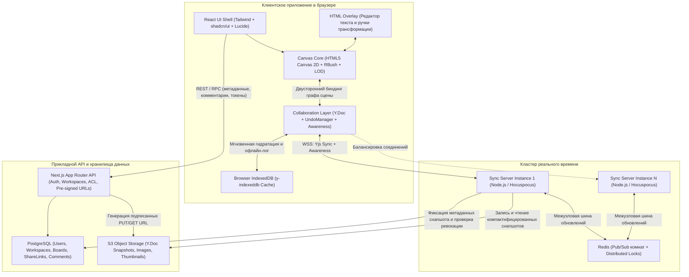
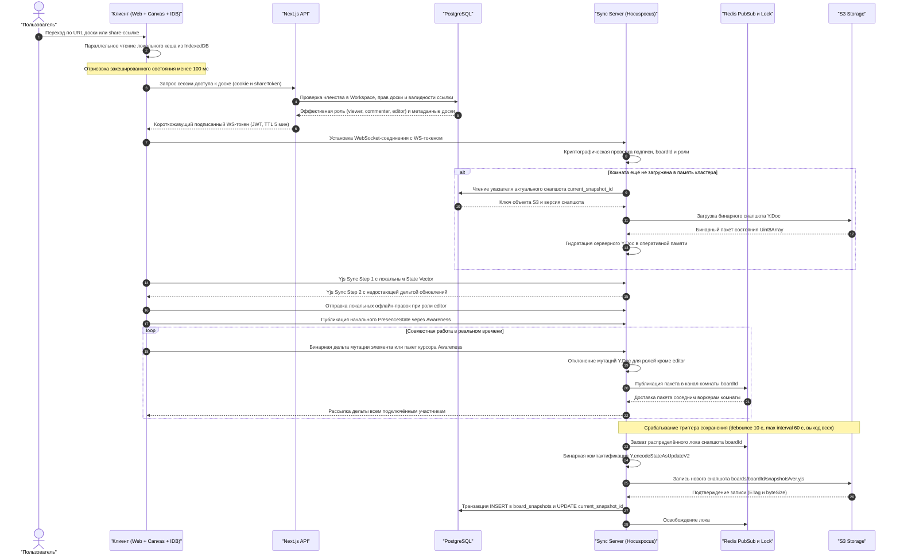

# Системная архитектура и технологический стек Doska

Навигация: [[00-Doska-MOC]] | [[01-Концепция-продукта]] | **Архитектура и стек** | [[03-План-реализации]]

---

## 1. Технологический стек и структура монорепозитория

### 1.1. Сводная матрица стека

| Слой системы | Технологии и библиотеки | Инженерное назначение |
| :--- | :--- | :--- |
| Фронтенд и приложение | `Next.js` (App Router), `React 19`, `TypeScript` (strict) | Маршрутизация дашборда и воркспейсов, SSR авторизации, API Route Handlers |
| UI-система и иконографика | `Tailwind CSS`, `shadcn/ui` (Radix UI), `Lucide` | Доступные неблокирующие панели, модальные окна шеринга, контекстные меню |
| Монорепозиторий и сборка | `pnpm` Workspaces + `Turborepo` | Инкрементальная сборка, кеширование задач, строгие границы пакетов |
| Движок холста | `HTML5 Canvas 2D`, `rbush`, `perfect-freehand` | Императивный рендеринг сцены 60 FPS, R-tree индекс `O(log N)`, сглаживание пера, интерфейс под `WebGL` / `PixiJS` |
| Реалтайм и CRDT | `Yjs`, `fractional-indexing`, `y-protocols/awareness`, `y-indexeddb` | Бесконфликтное слияние правок, порядок слоёв без переиндексации, живые курсоры, локальный офлайн-кеш |
| Сервер синхронизации | `Node.js`, `Hocuspocus` (`ws`), `Redis` Pub/Sub | Управление комнатами `Y.Doc` в памяти, валидация прав сокетов, горизонтальное масштабирование |
| Персистентность и медиа | `PostgreSQL` (`Drizzle ORM`), S3-совместимое хранилище (`MinIO` / `AWS S3` / `Cloudflare R2`) | Реляционные метаданные, ACL, комментарии в `PostgreSQL`; бинарные снапшоты `Y.Doc`, превью и изображения в `S3` |

### 1.2. Структура монорепозитория

Проект организуется как единый монорепозиторий под управлением `pnpm` и `Turborepo` с чётким разделением платформонезависимого ядра и инфраструктурных адаптеров:

```text
doska/
├── apps/
│   ├── web/                  # Next.js приложение: дашборд воркспейсов, редактор доски, HTTP API, выпуск токенов
│   └── sync-server/          # Выделенный Node.js / Hocuspocus WebSocket-шлюз синхронизации комнат Yjs
├── packages/
│   ├── canvas-core/          # Чистый TypeScript-движок холста: камера, матрицы, rbush, LOD, роутинг стрелок, Canvas 2D
│   ├── collaboration/        # Интеграция Yjs: Y.Doc <-> SceneGraph, UndoManager, Awareness, интерполяция курсоров, IndexedDB
│   ├── shared/               # Доменные типы, схемы валидации Zod, ролевая матрица ACL, утилиты fractional-indexing
│   └── db/                   # Схема PostgreSQL, миграции Drizzle ORM, репозитории пользователей, досок и комментариев
├── turbo.json
└── pnpm-workspace.yaml
```

Ключевое архитектурное правило зависимостей: пакет `packages/canvas-core` не зависит ни от `React`, ни от `Next.js`, ни от сетевого транспорта. Это позволяет тестировать геометрию и рендерер изолированно, а также переиспользовать модели в серверных воркерах экспорта и в будущей десктопной оболочке на `Tauri` (см. [[01-Концепция-продукта]]).

---

## 2. Компонентная архитектура и потоки данных

### 2.1. Общая компонентная диаграмма системы



### 2.2. Sequence-диаграмма открытия доски, синхронизации и компактификации



---

## 3. Архитектура движка бесконечного холста (`packages/canvas-core`)

### 3.1. Отделение цикла рендеринга от React

Дерево React отвечает исключительно за верхнюю шапку, боковые панели, диалог шеринга и контекстное меню выделенного объекта. Высокочастотные события указателя (`pointermove`, `wheel`), пересчёт камеры, входящие сетевые дельты и пакеты курсоров `Awareness` обрабатываются напрямую внутри императивного ядра `CanvasEngine`:

- Единый планировщик кадра `FrameScheduler` работает на базе `requestAnimationFrame` и выполняет отрисовку **только при взведённых флагах грязного состояния** (`dirtyStaticScene` или `dirtyDynamicOverlay`). Если на доске никто ничего не двигает, потребление CPU равно нулю.
- Холст разделён на два совмещённых `<canvas>` элемента с учётом `window.devicePixelRatio`:
  1. **Scene Canvas (нижний слой)**: сетка и все персистентные элементы доски, отсортированные по `zIndexKey`. Перерисовывается при движении камеры или изменении самих элементов.
  2. **Interaction Canvas (верхний слой)**: рамка `marquee`-выделения, ограничивающие рамки и направляющие `smart guides`, предпросмотр создаваемой стрелки, рамки чужого выделения и живые курсоры участников. Движение десятков чужих курсоров при неподвижной камере перерисовывает **только верхний лёгкий слой**, не затрагивая тысячи фигур основной сцены.
- **Абстракция бэкенда отрисовки (`IRenderBackend`)**: команды рисования примитивов изолированы за узким интерфейсом рендерера. В MVP используется высокооптимизированный `Canvas2DRenderer` с кешированием `Path2D` и текстовых разбиений строк; при масштабировании продукта на сверхтяжёлые доски с сотнями фотореалистичных макетов под тот же контракт подключается `WebGL` / `PixiJS` бэкенд без изменения логики инструментов, хит-тестинга и CRDT-синхронизации.

### 3.2. Координатная система и матрица камеры

Состояние камеры описывается тройкой `(x, y, zoom)`, где `(x, y)` — мировые координаты верхнего левого (или центрального) якоря вьюпорта, а `zoom` лежит в интервале `[0.02, 4.0]`.

- Прямое преобразование `World -> Screen`: `screenX = (worldX - camX) * zoom`, `screenY = (worldY - camY) * zoom`.
- Обратное преобразование `Screen -> World`: `worldX = screenX / zoom + camX`, `worldY = screenY / zoom + camY`.
- При масштабировании колесом или жестом `pinch` пересчёт выполняется так, чтобы мировая точка под курсором оставалась неподвижной на экране: сначала вычисляется `anchorWorld = screenToWorld(cursorScreen, oldZoom)`, затем после установки `newZoom` камера сдвигается так, чтобы `worldToScreen(anchorWorld, newZoom) === cursorScreen`.

### 3.3. Пространственный R-tree индекс (`rbush`) и `Viewport Culling`

Линейный обход всех объектов доски на каждом кадре недопустим на масштабе тысяч элементов. Каждый объект сцены хранит предрассчитанный выровненный по осям ограничивающий прямоугольник (`AABB`: `minX`, `minY`, `maxX`, `maxY`) в мировых координатах с учётом угла поворота `rotation` и толщины обводки, индексируемый в R-дереве `rbush`:

- **Пакетная гидратация**: при открытии снапшота массив рамок загружается вызовом `rbush.load(entries)`, который строит сбалансированное дерево за `O(N log N)` (для `10 000` элементов занимает единицы миллисекунд).
- **Отсечение вне кадра (`Viewport Culling`)**: перед отрисовкой кадра вычисляется мировой прямоугольник видимого экрана `viewportAABB` (с небольшим буфером под тени), выполняется запрос `rbush.search(viewportAABB)` за `O(log N + K)`, и только попавшие в выборку `K` элементов сортируются по `(zIndexKey, id)` и передаются рендереру.
- **Hit-testing и выделение рамкой**: клик мыши ищет кандидатов в `rbush` по точке `(worldX, worldY)` и проверяет точную геометрию (включая попадание в повёрнутый прямоугольник, эллипс или полилинию коннектора с допуском `6px / zoom`) сверху вниз по слоям.

### 3.4. Уровни детализации (`LOD` — Level of Detail)

При отдалении камеры (`zoom -> 0.02`) в кадр одновременно попадают все тысячи объектов доски, и `Viewport Culling` перестаёт сокращать выборку. Для удержания `60 FPS` рендерер применяет трёхступенчатый `LOD`:

| Диапазон масштаба `zoom` | Режим детализации | Отключаемые и упрощаемые операции |
| :--- | :--- | :--- |
| `zoom >= 0.40` | `LOD 0 (Full)` | Полная отрисовка: мягкие тени стикеров, скруглённые углы, многострочный текст, иконки авторов, сглаженные наконечники стрелок |
| `0.15 <= zoom < 0.40` | `LOD 1 (Medium)` | Отключение `ctx.shadowBlur` (замена на быстрый смещённый полупрозрачный прямоугольник), скрытие мелких подписей авторов, замена текста с экранным кеглем `< 5px` на закешированные серые полосы-заглушки (`text greeking`) |
| `zoom < 0.15` | `LOD 2 (Overview)` | Рендеринг стикеров и фигур как плоских залитых прямоугольников без границ и текста, упрощение кривых коннекторов до прямых сегментов, прореживание точек свободного рисования |

### 3.5. Свободное рисование и HTML-оверлей

- **Сглаживание штрихов (`perfect-freehand`)**: во время движения пера сырые события `PointerEvent` (включая коалесцированные точки `getCoalescedEvents()` для плавности на 120 Гц экранах) переводятся в локальные координаты штриха и передаются в `getStroke()`. Результирующий замкнутый полигон кешируется в объект `Path2D`, поэтому повторная отрисовка завершённого рукописного штриха сводится к одному вызову `ctx.fill(cachedPath)`.
- **HTML-оверлей**: располагается поверх `Interaction Canvas` с `pointer-events: none` на контейнере и точечным `pointer-events: auto` на активных виджетах. Когда пользователь делает двойной клик по стикеру, фигуре или текстовому блоку, движок скрывает отрисовку текста этого одного элемента на `Canvas` и монтирует поверх него точно совмещённый по матрице камеры DOM-редактор (`textarea` / `contentEditable`). После потери фокуса (`blur` или `Escape`) обновлённый текст фиксируется в `Y.Doc`, DOM-узел размонтируется, и элемент снова рендерится на `Canvas`.

---

## 4. Реалтайм-протокол, CRDT `Yjs` и модель данных холста

### 4.1. Организация документа `Y.Doc`

Корневой `Y.Doc` доски содержит строго типизированные верхнеуровневые коллекции:

1. `meta: Y.Map<unknown>` — версия схемы документа (`schemaVersion: 1`), настройки фона и сетки доски.
2. `elements: Y.Map<Y.Map<unknown>>` — плоский словарь всех элементов сцены по ключу `element.id`. Каждый элемент представлен собственным вложенным `Y.Map`, где каждое свойство (`x`, `y`, `width`, `height`, `fill`, `zIndexKey` и др.) является независимым ключом CRDT.
   - Если участник А перетаскивает стикер (меняя `x`, `y`), а участник Б в ту же миллисекунду перекрашивает его (меняя `fillColor`), обе операции сходятся без перезаписи друг друга.
   - Текстовое содержимое элементов хранится во вложенном `Y.Text` по ключу `text` внутри `Y.Map` элемента, что позволяет сохранять целостность при конкурентных вставках и корректно работать со стеком отмен.
3. **Порядок слоёв через `fractional-indexing`**:
   - Вместо хранения массива идентификаторов слоёв (где одновременная перестановка элементов в конец вызывает дубликаты или сдвиги индексов) у каждого объекта хранится лексикографический ключ `zIndexKey` (библиотека `fractional-indexing`).
   - Операция «На передний план» вычисляет `generateKeyBetween(currentMaxKey, null)` и меняет ровно одно поле целевого элемента.
   - При параллельном создании двух элементов на разных клиентах с одинаковым вычисленным `zIndexKey` порядок рендеринга детерминированно разрешается компаратором: `a.zIndexKey.localeCompare(b.zIndexKey) || a.id.localeCompare(b.id)`.
4. **Локальная история отмен (`Y.UndoManager`)**:
   - Инициализируется поверх `elements` с параметром `trackedOrigins: new Set([LOCAL_USER_ORIGIN])`.
   - Все локальные изменения из инструментов холста оборачиваются в `ydoc.transact(() => { ... }, LOCAL_USER_ORIGIN)`. Входящие сетевые обновления имеют origin провайдера и **никогда не попадают в локальный стек `Undo/Redo` пользователя**.
   - Непрерывный жест перетаскивания или изменения размера объединяется в одну точку возврата (`stopCapturing()` вызывается на `pointerup`).

### 4.2. TypeScript-интерфейсы модели данных холста (`packages/shared`)

```typescript
export type ElementId = string;
export type UserId = string;

export type BoardElementType =
  | "sticky"
  | "shape"
  | "text"
  | "connector"
  | "frame"
  | "freedraw"
  | "image";

export type StrokeStyle = "solid" | "dashed" | "dotted";
export type TextAlign = "left" | "center" | "right";
export type VerticalAlign = "top" | "middle" | "bottom";

export interface BoardElementBase {
  id: ElementId;
  type: BoardElementType;
  x: number;
  y: number;
  width: number;
  height: number;
  rotation: number;           // Угол поворота в радианах вокруг центра элемента
  zIndexKey: string;          // Ключ fractional-indexing для бесконфликтного порядка слоёв
  opacity: number;            // 0.1 .. 1.0
  parentFrameId: ElementId | null;
  isLocked: boolean;          // Защита от случайного сдвига на холсте
  createdBy: UserId;
  createdAt: number;          // Unix timestamp (ms)
  updatedAt: number;          // Unix timestamp (ms)
}

export interface StickyNoteElement extends BoardElementBase {
  type: "sticky";
  text: string;               // В Y.Doc представлено как Y.Text
  color:
    | "yellow"
    | "orange"
    | "pink"
    | "purple"
    | "blue"
    | "cyan"
    | "mint"
    | "green"
    | "gray"
    | "sand";
  fontSizeMode: "auto" | "fixed";
  fontSize: number;
  textAlign: TextAlign;
  authorName: string | null;
  showAuthor: boolean;
}

export type ShapeKind =
  | "rectangle"
  | "rounded-rectangle"
  | "ellipse"
  | "diamond"
  | "triangle"
  | "parallelogram"
  | "hexagon"
  | "cylinder"
  | "cloud";

export interface ShapeElement extends BoardElementBase {
  type: "shape";
  shapeKind: ShapeKind;
  fillColor: string;          // HEX/RGBA или "transparent"
  strokeColor: string;
  strokeWidth: number;
  strokeStyle: StrokeStyle;
  cornerRadius: number;
  text: string;               // В Y.Doc представлено как Y.Text
  fontSize: number;
  fontFamily: "sans" | "serif" | "mono";
  textColor: string;
  textAlign: TextAlign;
  verticalAlign: VerticalAlign;
}

export interface TextElement extends BoardElementBase {
  type: "text";
  text: string;               // В Y.Doc представлено как Y.Text с базовыми атрибутами форматирования
  autoWidth: boolean;
  fontSize: number;
  fontFamily: "sans" | "serif" | "mono";
  fontWeight: "normal" | "bold";
  fontStyle: "normal" | "italic";
  textDecoration: "none" | "line-through";
  listType: "none" | "bullet" | "numbered";
  textAlign: TextAlign;
  textColor: string;
}

export type PortSide = "auto" | "top" | "right" | "bottom" | "left";
export type ArrowheadKind = "none" | "arrow" | "triangle" | "diamond" | "circle";
export type ConnectorRouteType = "straight" | "curved" | "orthogonal";

export interface ConnectorEndpoint {
  boundElementId: ElementId | null;
  port: PortSide;
  /** Свободная мировая точка (используется, если boundElementId === null) */
  point: { x: number; y: number };
}

export interface ConnectorElement extends BoardElementBase {
  type: "connector";
  routeType: ConnectorRouteType;
  start: ConnectorEndpoint;
  end: ConnectorEndpoint;
  /** Промежуточные ручные изломы маршрута в мировых координатах */
  waypoints: Array<{ x: number; y: number }>;
  strokeColor: string;
  strokeWidth: number;
  strokeStyle: StrokeStyle;
  startArrowhead: ArrowheadKind;
  endArrowhead: ArrowheadKind;
  label: string;
  /** Позиция текстовой подписи вдоль траектории линии (0.0 .. 1.0) */
  labelPosition: number;
}

export interface FrameElement extends BoardElementBase {
  type: "frame";
  title: string;
  preset: "custom" | "16:9" | "4:3" | "a4" | "desktop" | "mobile";
  backgroundColor: string;
  strokeColor: string;
  clipContent: boolean;
  presentationOrder: string;  // fractional-indexing ключ для порядка слайдов в режиме презентации
}

export interface FreeDrawPoint {
  /** Локальные координаты относительно (element.x, element.y), округлённые до 0.1 */
  x: number;
  y: number;
  pressure: number;           // 0.0 .. 1.0
}

export interface FreeDrawElement extends BoardElementBase {
  type: "freedraw";
  brushKind: "pen" | "highlighter";
  strokeColor: string;
  strokeWidth: number;
  points: FreeDrawPoint[];
  simulatePressure: boolean;
}

export interface ImageCropRect {
  /** Нормализованные доли исходного изображения (0.0 .. 1.0) */
  x: number;
  y: number;
  width: number;
  height: number;
}

export interface ImageElement extends BoardElementBase {
  type: "image";
  assetId: string;            // Идентификатор записи в хранилище S3 / таблице ассетов
  naturalWidth: number;
  naturalHeight: number;
  mimeType: "image/png" | "image/jpeg" | "image/webp" | "image/svg+xml";
  altText: string;
  crop: ImageCropRect | null;
  uploadStatus: "uploading" | "ready" | "failed";
}

export type BoardElement =
  | StickyNoteElement
  | ShapeElement
  | TextElement
  | ConnectorElement
  | FrameElement
  | FreeDrawElement
  | ImageElement;

/** Эфемерное состояние участника в протоколе Yjs Awareness (не сохраняется в БД/S3) */
export interface PresenceState {
  sessionId: string;
  user: {
    id: UserId;
    displayName: string;
    avatarUrl: string | null;
    color: string;            // Назначенный контрастный цвет участника в комнате
    isGuest: boolean;
    role: "viewer" | "commenter" | "editor";
  };
  /** Текущая позиция курсора в мировых координатах (null, если курсор покинул окно) */
  cursor: {
    x: number;
    y: number;
    updatedAt: number;
  } | null;
  /** Массив идентификаторов элементов, выделенных участником в данный момент */
  selectedElementIds: ElementId[];
  /** Мягкая блокировка ввода текста: id элемента, в котором открыт текстовый редактор */
  editingElementId: ElementId | null;
  /** Состояние камеры участника (передаётся для подписчиков в режиме Follow mode) */
  camera: {
    x: number;
    y: number;
    zoom: number;
    viewportWidth: number;
    viewportHeight: number;
  };
  /** sessionId ведущего, за которым сейчас следует данный клиент */
  followingSessionId: string | null;
}
```

---

## 5. Серверная часть, схема PostgreSQL и жизненный цикл снапшотов

### 5.1. Схема ключевых таблиц `PostgreSQL`

Реляционная база данных обслуживает контур управления доступом, каталог досок, реестр версий снапшотов и ветки комментариев:

```sql
CREATE TYPE workspace_role AS ENUM ('owner', 'admin', 'editor', 'commenter', 'viewer');
CREATE TYPE share_access_level AS ENUM ('view', 'comment', 'edit');
CREATE TYPE comment_thread_status AS ENUM ('open', 'resolved');

CREATE TABLE users (
  id UUID PRIMARY KEY DEFAULT gen_random_uuid(),
  email TEXT UNIQUE NOT NULL,
  display_name TEXT NOT NULL,
  avatar_url TEXT,
  password_hash TEXT,
  created_at TIMESTAMPTZ NOT NULL DEFAULT now(),
  updated_at TIMESTAMPTZ NOT NULL DEFAULT now()
);

CREATE TABLE workspaces (
  id UUID PRIMARY KEY DEFAULT gen_random_uuid(),
  slug TEXT UNIQUE NOT NULL,
  name TEXT NOT NULL,
  owner_id UUID NOT NULL REFERENCES users(id) ON DELETE RESTRICT,
  allow_public_edit_links BOOLEAN NOT NULL DEFAULT true,
  default_workspace_access share_access_level, -- NULL означает доступ только по явному приглашению
  created_at TIMESTAMPTZ NOT NULL DEFAULT now(),
  updated_at TIMESTAMPTZ NOT NULL DEFAULT now()
);

CREATE TABLE workspace_members (
  workspace_id UUID NOT NULL REFERENCES workspaces(id) ON DELETE CASCADE,
  user_id UUID NOT NULL REFERENCES users(id) ON DELETE CASCADE,
  role workspace_role NOT NULL DEFAULT 'editor',
  joined_at TIMESTAMPTZ NOT NULL DEFAULT now(),
  PRIMARY KEY (workspace_id, user_id)
);

CREATE TABLE boards (
  id UUID PRIMARY KEY DEFAULT gen_random_uuid(),
  workspace_id UUID NOT NULL REFERENCES workspaces(id) ON DELETE CASCADE,
  folder_id UUID,                              -- Опциональная группировка по проекту/папке
  title TEXT NOT NULL DEFAULT 'Новая доска',
  thumbnail_s3_key TEXT,
  current_snapshot_id UUID,                    -- Внешний ключ на актуальный снапшот в board_snapshots
  element_count INTEGER NOT NULL DEFAULT 0,
  created_by UUID NOT NULL REFERENCES users(id) ON DELETE RESTRICT,
  archived_at TIMESTAMPTZ,                     -- Мягкое удаление в корзину
  last_edited_at TIMESTAMPTZ NOT NULL DEFAULT now(),
  created_at TIMESTAMPTZ NOT NULL DEFAULT now()
);
CREATE INDEX idx_boards_workspace_recent ON boards (workspace_id, archived_at, last_edited_at DESC);

CREATE TABLE board_share_links (
  id UUID PRIMARY KEY DEFAULT gen_random_uuid(),
  board_id UUID NOT NULL REFERENCES boards(id) ON DELETE CASCADE,
  token_hash TEXT UNIQUE NOT NULL,             -- SHA-256 хеш секретного токена ссылки
  access_level share_access_level NOT NULL DEFAULT 'view',
  password_hash TEXT,                          -- Опциональная защита ссылки паролем
  expires_at TIMESTAMPTZ,
  revoked_at TIMESTAMPTZ,
  created_by UUID NOT NULL REFERENCES users(id) ON DELETE RESTRICT,
  created_at TIMESTAMPTZ NOT NULL DEFAULT now()
);
CREATE INDEX idx_share_links_board_active ON board_share_links (board_id) WHERE revoked_at IS NULL;

CREATE TABLE board_snapshots (
  id UUID PRIMARY KEY DEFAULT gen_random_uuid(),
  board_id UUID NOT NULL REFERENCES boards(id) ON DELETE CASCADE,
  version_number BIGINT NOT NULL,
  s3_object_key TEXT NOT NULL,                 -- Путь к бинарному файлу Y.Doc в S3
  byte_size INTEGER NOT NULL,
  state_vector_b64 TEXT NOT NULL,              -- Компактный вектор состояния для быстрой диагностики
  label TEXT,                                  -- Опциональная именованная точка истории версий
  created_by UUID REFERENCES users(id) ON DELETE SET NULL,
  created_at TIMESTAMPTZ NOT NULL DEFAULT now(),
  UNIQUE (board_id, version_number)
);
ALTER TABLE boards
  ADD CONSTRAINT fk_boards_current_snapshot
  FOREIGN KEY (current_snapshot_id) REFERENCES board_snapshots(id) ON DELETE SET NULL;

CREATE TABLE comment_threads (
  id UUID PRIMARY KEY DEFAULT gen_random_uuid(),
  board_id UUID NOT NULL REFERENCES boards(id) ON DELETE CASCADE,
  world_x DOUBLE PRECISION NOT NULL,
  world_y DOUBLE PRECISION NOT NULL,
  attached_element_id TEXT,                    -- ID элемента в Y.Doc (если пин прикреплён к фигуре)
  offset_x DOUBLE PRECISION,                   -- Смещение относительно элемента при привязке
  offset_y DOUBLE PRECISION,
  status comment_thread_status NOT NULL DEFAULT 'open',
  resolved_by UUID REFERENCES users(id) ON DELETE SET NULL,
  resolved_at TIMESTAMPTZ,
  created_by_user_id UUID REFERENCES users(id) ON DELETE SET NULL,
  created_by_guest_name TEXT,
  created_at TIMESTAMPTZ NOT NULL DEFAULT now(),
  updated_at TIMESTAMPTZ NOT NULL DEFAULT now()
);
CREATE INDEX idx_comment_threads_board_status ON comment_threads (board_id, status);

CREATE TABLE comments (
  id UUID PRIMARY KEY DEFAULT gen_random_uuid(),
  thread_id UUID NOT NULL REFERENCES comment_threads(id) ON DELETE CASCADE,
  author_user_id UUID REFERENCES users(id) ON DELETE SET NULL,
  author_guest_name TEXT,
  body TEXT NOT NULL,
  mentioned_user_ids UUID[] NOT NULL DEFAULT '{}',
  edited_at TIMESTAMPTZ,
  created_at TIMESTAMPTZ NOT NULL DEFAULT now()
);
CREATE INDEX idx_comments_thread_created ON comments (thread_id, created_at ASC);
```

Дополнительно в том же пакете `packages/db` ведётся сервисная таблица `board_assets` (`id`, `board_id`, `s3_key`, `mime_type`, `byte_size`, `sha256`, `uploaded_by`, `created_at`) для контроля квот воркспейса и фоновой очистки осиротевших медиафайлов в S3.

### 5.2. Жизненный цикл комнаты в памяти `sync-server` и стратегия снапшотов

Сервис `apps/sync-server` управляет активными документами в оперативной памяти по чёткому конечному автомату состояний (`Cold -> Hydrating -> Active -> Persisting -> Draining -> Evicted`):

1. **Гидратация (`Hydrating`)**: когда первый пользователь подключается к доске `boardId`, воркер проверяет наличие комнаты в локальной памяти. Если её нет, воркер читает `current_snapshot_id` из `PostgreSQL`, скачивает соответствующий бинарный блоб из `S3`, проверяет наличие несохранённых инкрементальных дельт во временном `Redis Stream` буфере (на случай аварийного завершения предыдущего воркера) и применяет их к `Y.Doc`. Параллельные подключения в момент загрузки ожидают один общий `Promise` гидратации.
2. **Активная работа и масштабирование (`Active`)**: несколько реплик `sync-server` обмениваются бинарными пакетами `Yjs` и `Awareness` через `Redis Pub/Sub`. Для снижения межсерверного трафика рекомендуется балансировка с `sticky sessions` по `boardId` (консистентное хеширование на уровне ingress), при которой `Redis Pub/Sub` выступает бесшовным резервом на случай перераспределения подов.
3. **Политика сохранения снапшотов (триггеры сброса в S3)**:
   - **Debounce-интервал (`10 секунд`)**: если после серии правок наступает пауза длительностью 10 секунд, грязное состояние документа сбрасывается в S3.
   - **Максимальный интервал (`60 секунд`)**: при непрерывном шторме редактирования (например, командный брейншторм на 20 человек) принудительный чекпоинт выполняется каждые 60 секунд независимо от пауз.
   - **Закрытие последней сессии и `SIGTERM`**: когда последний подключённый сокет покидает комнату, запускается немедленный финальный сброс снапшота. После успешной записи комната остаётся в памяти в состоянии `Idle Grace Period` ещё на `30 секунд` (чтобы мгновенно обслужить `F5` перезагрузку страницы без повторного похода в S3), после чего `Y.Doc` уничтожается (`ydoc.destroy()`) и память освобождается.
4. **Компактификация и защита от гонок**:
   - Перед записью воркер берёт короткий распределённый ключ блокировки в `Redis` (`SET snapshot:lock:{boardId} {nodeId} NX EX 15`).
   - Состояние сериализуется компактным кодеком `Y.encodeStateAsUpdateV2(ydoc)` (сжимающим последовательности вставок и метаданные во много раз эффективнее v1) и загружается в S3 под новым версионированным ключом `boards/{boardId}/snapshots/{version}_{uuid}.yjs` — старые файлы никогда не перезаписываются на месте, что исключает повреждение снапшота при обрыве записи и даёт готовую базу для истории версий доски.

---

## 6. Безопасность и контроль доступа

1. **Короткоживущие подписанные токены WebSocket**:
   - Сервер `sync-server` не ходит в базу данных на каждый пакет. При открытии страницы доски `apps/web` проверяет сессию пользователя и/или публичный `shareToken` по `PostgreSQL` и выпускает компактный `JWT` (алгоритм `EdDSA` / `HMAC-SHA256`, время жизни `5 минут` для рукопожатия + фоновое продление токена открытой вкладкой).
   - Payload токена: `{ sub: userIdOrGuestId, boardId, role: "viewer" | "commenter" | "editor", isGuest: boolean, linkId?: string, exp }`.
2. **Принудительный контроль прав на уровне бинарного протокола**:
   - На этапе `onAuthenticate` и в хуке обработки входящих кадров `sync-server` инспектирует тип сообщения `Yjs`. Если в токене сокета указана роль `viewer` или `commenter`, любые клиентские фреймы изменения `Y.Doc` (`SyncStep2` с непустым апдейтом и `Update` сообщения) жёстко отбрасываются на сервере и логируются как нарушение прав.
   - При отзыве публичной ссылки (`revoke`) или удалении участника из воркспейса `apps/web` публикует управляющее событие в канал `Redis` `acl:invalidate:{boardId}`; все узлы `sync-server` мгновенно проверяют открытые сокеты этой комнаты и закрывают затронутые соединения с прикладным кодом `4403 Forbidden`.
3. **Безопасная работа с медиа через Pre-signed S3 URLs**:
   - Браузер никогда не проксирует тяжёлые файлы через Node.js воркеры. Клиент с ролью `editor` запрашивает у `apps/web` одноразовый `PUT` pre-signed URL, где в криптографическую подпись зашиты точный `Content-Type` (`image/png`, `image/jpeg`, `image/webp`, `image/svg+xml`), верхний лимит `Content-Length` (`15 МБ`) и `SHA-256` дайджест файла.
   - Для чтения приватных изображений с доски выдаются короткоживущие подписанные `GET` URL пакетным запросом при открытии доски.
   - Загружаемые `SVG` проходят серверную/клиентскую очистку от `<script>`, внешних ссылок и `on*` обработчиков и растеризуются в изолированный `ImageBitmap` без встраивания в DOM страницы.
4. **Защита от сетевого флуда (Rate Limiting)**:
   - На уровне сокета в `sync-server` ограничивается максимальный размер одного фрейма (`2 МБ`) и частота сообщений `Awareness` (токен-бакет с отсечкой избыточных пакетов курсора без разрыва легитимной сессии).

---

## 7. Целевые показатели производительности (Performance Budgets и SLO)

Все проектные решения из разделов 3–5 подчинены измеримым инженерным целевым показателям (методика их автоматической проверки в CI зафиксирована в [[03-План-реализации]]):

| Метрика | Целевой показатель | Архитектурный механизм обеспечения |
| :--- | :--- | :--- |
| Частота кадров при `pan` / `zoom` / `drag` на доске из `5 000+` элементов | Стабильные `60 FPS` (время кадра `< 16.6 мс`, бюджет JS `< 8 мс`) | Вне-реактовский цикл `Canvas 2D`, `rbush` culling `O(log N + K)`, разделение статического и курсорного слоёв, 3 уровня `LOD` |
| Время до первого интерактивного кадра при повторном визите | `< 100 мс` | Локальная гидратация `Y.Doc` из `IndexedDB` (`y-indexeddb`) параллельно сетевому запросу токена |
| Холодная загрузка доски (`5 000` элементов) без локального кеша | `< 800 мс` (p95) | Компактифицированный бинарный снапшот `Yjs V2` в S3 + пакетная загрузка `rbush.load()` |
| Частота сетевой отправки локального курсора | `30–60 Гц` (троттлинг `16–33 мс`, адаптивное снижение до `20 Гц` при `> 30` участниках) | Троттлинг исходящего `Awareness` + клиентская плавная интерполяция (`lerp` / кубический сплайн) под частоту монитора `60–120 Гц` |
| Задержка доставки правки или курсора между участниками одного региона | `< 80 мс` (p95) | Бинарный WebSocket-протокол без JSON-сериализации и `sticky` маршрутизация на узел комнаты |
| Потребление памяти вкладки на насыщенной доске (`5 000` фигур + `50` изображений) | `< 350 МБ` RAM | Downscaling текстур `ImageBitmap` (mipmaps) под экранный размер, выгрузка далёких полноразмерных текстур и кеш `Path2D` |
