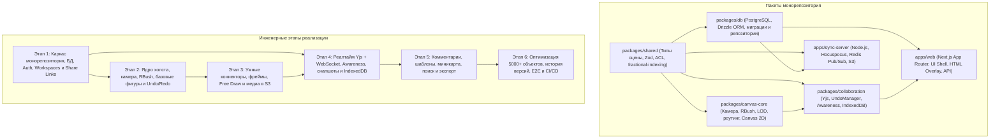

# Инженерный план реализации Doska

Навигация: [[00-Doska-MOC]] | [[01-Концепция-продукта]] | [[02-Архитектура-и-стек]] | **План реализации**

---

## 1. Принципы итеративной сборки и карта зависимостей подсистем

### 1.1. Инженерные принципы поставки

Разработка **Doska** строится вокруг ранней проверки самых сложных архитектурных инвариантов — производительности императивного рендерера холста, детерминированной сходимости CRDT-модели и строгого принудительного контроля прав доступа на уровне протокола синхронизации:

1. **Вертикальные проверяемые срезы поверх чистых контрактов**: общие доменные типы сцены, схемы валидации `Zod`, матрица разрешений ACL и утилиты `fractional-indexing` фиксируются в `packages/shared` до написания клиентских инструментов и серверных обработчиков. Каждый следующий этап завершается работающим и автоматически тестируемым состоянием продукта.
2. **Строгая изоляция ядра холста (`packages/canvas-core`)**: геометрическое ядро, матрица камеры, пространственный индекс `rbush`, маршрутизация коннекторов и двуслойный `Canvas 2D` рендерер разрабатываются и покрываются тестами без зависимости от `React`, `Next.js` и сетевого стека. Это исключает протекание жизненного цикла UI-компонентов в горячий цикл отрисовки кадра.
3. **Единая CRDT-модель с локального режима до мультиплеера**: даже до подключения сетевого транспорта `WebSocket` локальное состояние холста на Этапах 2 и 3 опирается на структуру `Y.Doc` (`elements: Y.Map<Y.Map<unknown>>` + `Y.UndoManager`). Благодаря этому переход к синхронному мультиплееру на Этапе 4 заключается в подключении сетевого и `IndexedDB` провайдеров без переписывания инструментов рисования и истории отмен.
4. **Инварианты безопасности и производительности как блокирующие ворота**: правила отбрасывания неавторизованных бинарных фреймов в `sync-server` и синтетические бюджеты кадра (`< 16.6 мс` на сцене из `5 000+` элементов) встраиваются в автоматизированный конвейер проверки изменений.

### 1.2. Граф зависимостей пакетов монорепозитория и этапов реализации

Сборка организована в монорепозитории `pnpm` + `Turborepo`, где направленный ациклический граф пакетов напрямую определяет порядок развёртывания шести инженерных этапов (архитектурные контракты модулей описаны в [[02-Архитектура-и-стек]], продуктовые сценарии — в [[01-Концепция-продукта]]):

### 1.3. Матрица покрытия пакетов по этапам

| Пакет / Приложение | Этап 1 | Этап 2 | Этап 3 | Этап 4 | Этап 5 | Этап 6 |
| :--- | :---: | :---: | :---: | :---: | :---: | :---: |
| `packages/shared` | Базовые типы, ACL, `Zod` | Типы базовых фигур и `zIndexKey` | Типы коннекторов, фреймов, пера, медиа | Типы `PresenceState`, токены WS | Схемы шаблонов, комментариев, экспорта | Метрики телеметрии и версий |
| `packages/db` | `users`, `workspaces`, `boards`, `board_share_links` | — | `board_assets` (метаданные S3) | `board_snapshots` и указатели версий | `comment_threads`, `comments` | Индексы истории снапшотов и очистки |
| `packages/canvas-core` | — | Камера, `rbush`, выделение, стикеры, фигуры, текст | Ортогональные стрелки, порты, фреймы, `perfect-freehand`, `Image` | Отрисовка чужих курсоров, рамок и `Soft Text Lock` | Рендер пинов, миникарты, подсветки поиска, `SVG`/`PNG` экспорт | 3 уровня `LOD`, кеш `Path2D`, mipmap-пул текстур |
| `packages/collaboration` | — | Локальный биндинг `Y.Doc <-> Scene`, `Y.UndoManager` | Транзакции усыновления фреймов и групповых правок | Провайдер `WebSocket`, `Awareness`, интерполяция курсоров, `y-indexeddb` | Синхронизация координат привязанных пинов | Пакетное слияние транзакций и дифф-обновлений |
| `apps/sync-server` | — | — | — | Комнаты `Hocuspocus`, проверка JWT/ролей, `Redis Pub/Sub`, сброс в `S3` | Проброс событий инвалидации прав и уведомлений | Graceful drain по `SIGTERM`, лимиты фреймов, метрики |
| `apps/web` | Auth, дашборд воркспейсов, каталог досок, гостевой вход | Экран редактора, тулбар, контекстная панель, HTML-оверлей текста | UI портов, панель фреймов, презентация, загрузка файлов в S3 | Шапка присутствия, аватарки, `Follow mode`, индикатор сети | Панель тредов комментариев, галерея шаблонов, поиск `Cmd+F`, диалог экспорта | Окно истории версий доски и восстановления снапшота |

---

## 2. Детальная декомпозиция по 6 инженерным этапам

### Этап 1. Архитектурный каркас монорепозитория, БД, аутентификация, воркспейсы и шеринг по ссылке

- **Цель этапа**: развернуть воспроизводимую инфраструктуру монорепозитория и локального окружения, реализовать реляционную модель управления доступом, дашборд командных воркспейсов, жизненный цикл метаданных досок и бесшовный вход по публичным и командным ссылкам с вычислением эффективной роли.
- **Затрагиваемые пакеты**: `packages/shared`, `packages/db`, `apps/web`, корневые конфигурации `pnpm-workspace.yaml`, `turbo.json`, `docker-compose.yml`.
- **Входные зависимости**: зафиксированные контракты ролевой модели RBAC из [[01-Концепция-продукта]] (раздел 3) и SQL-схема из [[02-Архитектура-и-стек]] (раздел 5.1).
- **Инженерные задачи**:
  1. Настроить монорепозиторий `pnpm` + `Turborepo` с общими пресетами `TypeScript` (`strict: true`, `noUncheckedIndexedAccess: true`), `ESLint`, форматированием и пайплайном задач `build`, `lint`, `typecheck`, `test`.
  2. Подготовить локальный `docker-compose.yml` с контейнерами `PostgreSQL`, `Redis` и S3-совместимым хранилищем `MinIO` (с автосозданием бакета для снапшотов и ассетов).
  3. Реализовать в `packages/db` схему и миграции `Drizzle ORM` для таблиц `users`, `workspaces`, `workspace_members`, `boards` (включая папки/проекты и мягкое удаление `archived_at`) и `board_share_links`.
  4. Реализовать в `packages/shared` чистую функцию вычисления эффективной роли `resolveEffectiveRole(workspaceRole, boardOverrideRole, shareLink, workspacePolicy)` с учётом запрета публичных `edit`-ссылок на уровне воркспейса.
  5. Внедрить в `apps/web` аутентификацию пользователей (сессии в `HttpOnly` cookie, регистрация/вход по учётным данным и OAuth-провайдерам), а также механику подписанной гостевой сессии (`guestId` cookie + автогенерация читаемого псевдонима и цвета без принудительной регистрации).
  6. Собрать интерфейс дашборда воркспейса (`shadcn/ui` + `Tailwind CSS`): переключение воркспейсов, управление участниками и ролями (`Owner`, `Admin`, `Editor`, `Commenter`, `Viewer`), навигация по проектам/папкам, представления «Все доски», «Недавние», «Избранные», «Корзина», создание, переименование и дублирование досок.
  7. Реализовать диалог шеринга доски и API выпуска/отзыва публичных ссылок (`SHA-256` хеширование токена в БД, уровни `view` / `comment` / `edit`, параметр истечения `expires_at`, опциональная защита паролем) и эндпоинт выдачи короткоживущего подписанного `JWT` для будущего подключения к комнате доски.
- **Критерии готовности (`Definition of Done`)**:
  - Команды `pnpm turbo typecheck`, `pnpm turbo lint` и `pnpm turbo build` проходят с нулём ошибок во всех пакетах.
  - Развёртывание с чистого состояния (`docker compose up -d && pnpm db:migrate`) поднимает рабочую среду с применёнными миграциями.
  - Unit-тесты матрицы `resolveEffectiveRole` в `packages/shared` покрывают 100% комбинаций ролей воркспейса (`Owner`..`Viewer`), уровней ссылки (`view`, `comment`, `edit`), истёкших/отозванных токенов и флага `allow_public_edit_links = false`.
  - Неавторизованный клиент при переходе по валидной публичной ссылке открывает страницу доски без редиректа на экран регистрации, получает стабильный `guestId`, временное имя и ровно тот уровень прав, который закодирован в ссылке и разрешён политикой воркспейса.

---

### Этап 2. Ядро бесконечного холста, камера, пространственный индекс `rbush`, выделение, базовые фигуры/стикеры/текст и `Undo/Redo`

- **Цель этапа**: построить императивный двуслойный движок бесконечного холста вне цикла ререндера React, реализовать точную математику камеры и пространственного индекса, базовые примитивы диаграмм и брейншторминга, HTML-оверлей редактирования текста и изолированный стек локальных отмен на базе `Yjs`.
- **Затрагиваемые пакеты**: `packages/shared`, `packages/canvas-core`, `packages/collaboration`, `apps/web`.
- **Входные зависимости**: завершённый Этап 1 (маршрут страницы доски в `apps/web` и базовый пакет `packages/shared`).
- **Инженерные задачи**:
  1. Определить в `packages/shared` интерфейсы и `Zod`-схемы для `BoardElementBase`, `StickyNoteElement`, `ShapeElement`, `TextElement` и утилиты генерации ключей порядка слоёв на `fractional-indexing` с детерминированным компаратором `(zIndexKey, id)`.
  2. Реализовать в `packages/canvas-core` систему координат и камеру `(x, y, zoom)` в диапазоне `[0.02, 4.0]`: прямое/обратное преобразование `World <-> Screen`, масштабирование относительно точки под курсором, жесты тачпада (`pan` / `pinch-to-zoom`), панорамирование через `Space + Drag` и колесо мыши, команды `Zoom to 100%`, `Zoom to Fit`, `Zoom to Selection`, адаптивную сетку и привязку `snap-to-grid`.
  3. Спроектировать планировщик кадра `FrameScheduler` с раздельными флагами грязного состояния (`dirtyStaticScene`, `dirtyDynamicOverlay`), два совмещённых `<canvas>` слоя с учётом `devicePixelRatio` и абстракцию `IRenderBackend` с реализацией `Canvas2DRenderer`.
  4. Интегрировать R-дерево `rbush`: расчёт выровненных по осям ограничивающих рамок (`AABB`) с учётом угла поворота `rotation` и толщины обводки, пакетную загрузку `rbush.load()`, отсечение невидимых объектов `Viewport Culling` и геометрический `hit-testing` сверху вниз по `zIndexKey`.
  5. Реализовать конечный автомат инструментов выделения и трансформации: одиночный клик, `Shift + Click`, выделение рамкой `marquee`, групповой `bounding box`, перемещение, пропорциональное и свободное масштабирование, вращение, выравнивание с динамическими направляющими `Smart Guides` (совпадение центров/граней и равные интервалы), дублирование (`Cmd/Ctrl + D`, `Alt + Drag`), системный буфер обмена, смену порядка слоёв и блокировку `isLocked`.
  6. Реализовать рендеринг и создание базовых примитивов:
     - `StickyNoteElement`: 10 пастельных цветов, автоматический подбор кегля шрифта под объём текста (`auto-fit`), подпись автора, быстрое создание соседнего стикера по `Tab`.
     - `ShapeElement`: 9 геометрических форм (прямоугольник, скруглённый прямоугольник, эллипс, ромб, треугольник, параллелограмм, шестиугольник, цилиндр, облако), настройки заливки, обводки и штриха.
     - `TextElement`: авторасширяемая строка и колонка фиксированной ширины, начертания, списки и выравнивание.
  7. Реализовать HTML-оверлей ввода текста: точечное монтирование `textarea` / `contentEditable` поверх редактируемого элемента с синхронизацией матрицы камеры, скрытием дублирующего текста на `Canvas` на время ввода и фиксацией результата по `blur` / `Escape`.
  8. Реализовать в `packages/collaboration` двустороннюю синхронизацию локального `Y.Doc` (`elements: Y.Map<Y.Map<unknown>>` + `Y.Text`) с графом сцены `CanvasEngine` и настроить `Y.UndoManager` с `trackedOrigins: new Set([LOCAL_USER_ORIGIN])` и группировкой непрерывного жеста перетаскивания в один шаг отмены.
- **Критерии готовности (`Definition of Done`)**:
  - Пакет `packages/canvas-core` не содержит импортов `react`, `react-dom` или `next` (проверяется правилом линтера и графом зависимостей).
  - При неподвижной камере и отсутствии пользовательского ввода `FrameScheduler` выполняет `0` вызовов перерисовки кадра.
  - Все горячие клавиши навигации, выбора примитивов (`V`, `H`, `S`, `R`, `O`, `D`, `T`), групповых трансформаций, смены слоёв и `Undo/Redo` (`Cmd/Ctrl + Z` / `Cmd/Ctrl + Shift + Z`) работают консистентно; перетаскивание группы из 50 объектов откатывается одним нажатием `Cmd/Ctrl + Z`.
  - Unit-тесты подтверждают обратимость преобразований `screenToWorld(worldToScreen(p))` без накопления погрешности и совпадение результатов `rbush.search(viewport)` с эталонным полным перебором.

---

### Этап 3. Умные коннекторы с привязкой к узлам, фреймы, свободное рисование (`perfect-freehand`) и загрузка медиа в `S3`

- **Цель этапа**: довести редактор холста до полной функциональной спецификации объектной модели MVP за счёт связных графов (`Connector`), структурных контейнеров и слайдов (`Frame`), естественного рукописного ввода (`Free Draw`) и безопасного конвейера загрузки изображений напрямую в `S3`.
- **Затрагиваемые пакеты**: `packages/shared`, `packages/db`, `packages/canvas-core`, `packages/collaboration`, `apps/web`.
- **Входные зависимости**: завершённые Этап 1 (инфраструктура `S3` и таблица прав досок) и Этап 2 (движок сцены, `rbush`, транзакции `Y.Doc`).
- **Инженерные задачи**:
  1. Расширить `packages/shared` контрактами `ConnectorElement`, `FrameElement`, `FreeDrawElement`, `ImageElement` и добавить в `packages/db` таблицу `board_assets` (`id`, `board_id`, `s3_key`, `mime_type`, `byte_size`, `sha256`, `uploaded_by`).
  2. Реализовать подсистему умных коннекторов в `packages/canvas-core`:
     - Магнитные порты привязки (`top`, `right`, `bottom`, `left` и динамический порт `auto`) с визуальной подсветкой при наведении курсора.
     - Три алгоритма трассировки: прямой отрезок (`straight`), кубическая кривая Безье (`curved`) и ортогональный маршрутизатор под прямыми углами со скруглёнными изгибами и базовым огибанием рамок привязанных фигур (`orthogonal`).
     - Индекс обратных зависимостей `boundElementId -> Set<ConnectorId>` в памяти сцены для мгновенного пересчёта траекторий и `AABB` привязанных стрелок при перемещении, масштабировании или вращении узлов.
     - Отрисовка наконечников (`none`, `arrow`, `triangle`, `diamond`, `circle`), ручных точек излома (`waypoints`) и редактируемой текстовой плашки на линии (`labelPosition` в диапазоне `0..1`).
  3. Реализовать контейнер `FrameElement` и режим презентации:
     - Пресеты размеров (`16:9`, `4:3`, `A4`, `Desktop`, `Mobile`, `Custom`), редактируемый заголовок и опция обрезки содержимого по контуру (`ctx.clip()` при `clipContent = true`).
     - Автоматическое усыновление (`parenting`): при завершении перетаскивания элемента внутрь границ фрейма в одной транзакции `Y.Doc` выставляется `parentFrameId`, а перемещение фрейма сдвигает все дочерние объекты с сохранением единого шага `Undo`.
     - Боковая панель списка фреймов с сортировкой по `presentationOrder` (`fractional-indexing`) и полноэкранный режим презентации с плавной интерполяцией перелёта камеры между фреймами по клавишам стрелок.
  4. Реализовать инструмент свободного рисования (`FreeDrawElement`) и поэлементный ластик:
     - Сбор точек `PointerEvent` (включая `getCoalescedEvents()` и давление стилуса `pressure`), нормализация в локальные координаты элемента с округлением до `0.1`, построение сглаженного контура через `perfect-freehand` для режимов `pen` и полупрозрачного `highlighter`.
     - Кеширование построенного полигона в `Path2D` для быстрой повторной отрисовки и инструмент `Stroke Eraser`, проверяющий пересечение траектории ластика с сегментами штрихов через `rbush`.
  5. Реализовать конвейер работы с изображениями (`ImageElement`):
     - Приём `PNG`, `JPEG`, `WebP`, `SVG` через `Paste`, `Drag-and-Drop` в мировую точку курсора и системный диалог выбора файлов.
     - Мгновенный оптимистичный рендер локального `ObjectURL` / `ImageBitmap` со статусом `uploading`, запрос одноразового `PUT` pre-signed URL у `apps/web` (с проверкой роли `editor`, лимита `15 МБ`, `Content-Type` и `SHA-256`), прямая загрузка в `S3` и перевод элемента в статус `ready` с записью `assetId`.
     - Санитизация загружаемых `SVG` (удаление `<script>`, внешних ресурсов и `on*` атрибутов) перед растеризацией в изолированный `ImageBitmap`, а также инструмент неразрушающего кадрирования `crop`.
- **Критерии готовности (`Definition of Done`)**:
  - Перемещение узла с 20 привязанными ортогональными коннекторами перестраивает все маршруты синхронно в том же кадре без визуального отставания концов стрелок и корректно обновляет их `AABB` в `rbush`.
  - Перетаскивание фрейма перемещает все вложенные элементы, а однократный `Undo` возвращает фрейм и все его дочерние элементы в исходные координаты.
  - Загрузка валидного изображения напрямую сохраняет объект в `S3` через pre-signed URL без проксирования тела файла через сервер приложения; попытка загрузить файл `> 15 МБ`, неподдерживаемый MIME-тип или вредоносный `SVG` с `<script>` блокируется валидацией и санитизацией.

---

### Этап 4. Слой реального времени (`Yjs` + `WebSocket`), `Awareness` (курсоры, присутствие, `Follow mode`), компактификация снапшотов и офлайн-кеш `IndexedDB`

- **Цель этапа**: превратить однопользовательский редактор в отказоустойчивую распределённую систему совместной работы с мгновенным локальным стартом из `IndexedDB`, живым присутствием участников, горизонтально масштабируемым кластером `sync-server` и надёжным сохранением компактифицированных снапшотов в `S3`.
- **Затрагиваемые пакеты**: `packages/shared`, `packages/db`, `packages/collaboration`, `packages/canvas-core`, `apps/sync-server`, `apps/web`.
- **Входные зависимости**: завершённые Этап 1 (выпуск подписанных WS-токенов и ACL) и Этапы 2–3 (полная модель элементов холста поверх `Y.Doc`).
- **Инженерные задачи**:
  1. Реализовать выделенный сервис `apps/sync-server` на базе `Node.js` и `Hocuspocus` (`ws`):
     - Криптографическая валидация короткоживущего `JWT` на рукопожатии (`sub`, `boardId`, `role`, `isGuest`, `linkId`, `exp`) и фоновое обновление токена открытым клиентом.
     - Жёсткая фильтрация бинарных фреймов протокола `Yjs`: клиенты с ролями `viewer` и `commenter` могут обмениваться состояниями чтения и пакетами `Awareness`, но любые мутации `Y.Doc` с их сокетов отклоняются сервером с логированием инцидента.
     - Подписка на канал `Redis` `acl:invalidate:{boardId}` для мгновенного разрыва или понижения прав активных гостевых и пользовательских сокетов с кодом `4403 Forbidden` при отзыве публичной ссылки или исключении участника.
  2. Реализовать конечный автомат жизненного цикла комнаты (`Cold -> Hydrating -> Active -> Persisting -> Draining -> Evicted`) и шину масштабирования:
     - Дедупликация конкурентных запросов гидратации комнаты через единый `Promise`, чтение актуального снапшота из `S3` по `boards.current_snapshot_id` из `PostgreSQL` и доигрывание страховочного буфера инкрементальных дельт из `Redis Stream`.
     - Межузловая синхронизация обновлений `Y.Doc` и `Awareness` между репликами `sync-server` через `Redis Pub/Sub` и защита от сетевого флуда (лимит фрейма `2 МБ` + токен-бакет на частоту `Awareness`).
  3. Реализовать механизм компактификации и записи снапшотов:
     - Триггеры сброса: `debounce 10 с` после затишья, принудительный чекпоинт каждые `60 с` при непрерывном потоке правок, немедленный сброс при выходе последнего участника с удержанием комнаты в `Idle Grace Period` (`30 с`) и при получении сигнала `SIGTERM`.
     - Захват распределённой блокировки `Redis` (`SET snapshot:lock:{boardId} NX EX 15`), сериализация состояния через `Y.encodeStateAsUpdateV2(ydoc)`, запись неизменяемого объекта `boards/{boardId}/snapshots/{version}_{uuid}.yjs` в `S3` и атомарное обновление таблицы `board_snapshots` и поля `boards.current_snapshot_id` в транзакции `PostgreSQL`.
  4. Подключить на клиенте в `packages/collaboration` local-first кеш `y-indexeddb` и сетевой WebSocket-провайдер с экспоненциальным `backoff` переподключения:
     - Параллельная гидратация сцены из `IndexedDB` до ответа сети, буферизация локальных офлайн-правок и автоматический обмен `state vector` при восстановлении связи.
     - Строгая проверка изоляции `Y.UndoManager`: входящие удалённые транзакции применяются с сетевым `origin` и не затрагивают локальный стек отмен пользователя.
  5. Реализовать протокол присутствия `PresenceState` (`Awareness`) в `packages/collaboration`, `packages/canvas-core` и `apps/web`:
     - Троттлинг отправки локального курсора (`16–33 мс` с адаптивным переходом к `50 мс` при `> 30` активных участниках в комнате) и плавная интерполяция движения чужих курсоров на верхнем слое `Interaction Canvas` без перерисовки основной сцены.
     - Индикация чужих рамок выделения персональным цветом участника и механизм мягкой блокировки текстового ввода `Soft Text Lock` (`editingElementId`), автоматически очищающийся при потере фокуса или обрыве сокета.
     - Шапка активных участников доски (разделение членов воркспейса и гостей) и режим `Follow mode` (синхронное следование камеры за выбранным ведущим, рамка статуса вьюпорта, мгновенный выход при ручном сдвиге камеры ведомым и действие «Позвать всех ко мне»).
- **Критерии готовности (`Definition of Done`)**:
  - Повторное открытие закешированной доски отображает интерактивный холст из `IndexedDB` быстрее `< 100 мс` даже при полностью отключённой сети; правки, внесённые на двух изолированных офлайн-клиентах, после восстановления связи сходятся к побитово идентичному графу сцены.
  - Локальный `Cmd/Ctrl + Z` у пользователя А никогда не отменяет параллельные создания или перемещения фигур, выполненные пользователем Б.
  - Попытка отправки скомпрометированным клиентом с ролью `viewer` бинарного пакета мутации `Y.Doc` блокируется `sync-server`, состояние комнаты не изменяется; отзыв публичной ссылки в UI немедленно отключает открытый гостевой сокет с кодом `4403`.
  - При работе двух экземпляров `sync-server` за `Redis` клиенты, подключённые к разным узлам одной доски, видят правки и курсоры друг друга в реальном времени, а при перезапуске воркера ни одна подтверждённая операция не теряется.

---

### Этап 5. Командные механики (треды комментариев на холсте, библиотека шаблонов, мини-карта, поиск по доске и экспорт в `PNG` / `SVG` / `PDF`)

- **Цель этапа**: оснастить доску инструментами асинхронной и синхронной командной работы вокруг контента — координатными и привязанными тредами обсуждений, быстрым стартом по шаблонам, обзорной навигацией по крупным схемам и высококачественным экспортом результатов.
- **Затрагиваемые пакеты**: `packages/shared`, `packages/db`, `packages/canvas-core`, `packages/collaboration`, `apps/sync-server`, `apps/web`.
- **Входные зависимости**: завершённые Этапы 3 и 4 (все типы примитивов холста, работающий мультиплеер и ролевая модель с ролью `commenter`).
- **Инженерные задачи**:
  1. Реализовать подсистему комментариев и тредов:
     - Миграции `Drizzle ORM` в `packages/db` для таблиц `comment_threads` и `comments` и защищённые API-маршруты в `apps/web` (доступ на запись для ролей `commenter`, `editor`, `admin`, `owner`, включая гостей по ссылке с правом `comment`).
     - Размещение пинов как в свободных мировых координатах `(world_x, world_y)`, так и с привязкой к конкретному объекту (`attached_element_id` + локальное смещение `offset_x`, `offset_y`), при которой пин автоматически следует за перемещением фигуры или стикера на холсте.
     - Боковая панель и поповер треда: ответы в реальном времени (доставка уведомлений о новых репликах через комнату `sync-server`), редактирование и удаление своих сообщений, упоминания участников воркспейса `@name`, фильтрация по статусам `Open` / `Resolved` и скрытие решённых пинов с полотна.
  2. Спроектировать библиотеку стартовых шаблонов (`Templates`):
     - Декларативный JSON-формат шаблона в `packages/shared` с генерацией свежих `UUID`, пересчётом относительных координат и привязок коннекторов (`boundElementId`) в точку вставки.
     - Набор встроенных шаблонов для ключевых сценариев из [[01-Концепция-продукта]]: ретроспектива (`Start / Stop / Continue / Action Items`), матрица командного планирования, C4 / системная архитектура, `Customer Journey Map (CJM)` и `User Flow`.
     - Модальная галерея выбора шаблона при создании пустой доски или вставке шаблона в свободную область существующего холста в рамках одной транзакции `Y.Doc`.
  3. Реализовать обзорную миникарту и мгновенный поиск по доске (`Cmd/Ctrl + F`):
     - Сворачиваемый виджет миникарты в `packages/canvas-core` с облегчённым рендером проекции всех элементов сцены (с троттлингом перерисовки фона миникарты) и интерактивной рамкой текущего вьюпорта с поддержкой клика и перетаскивания.
     - Клиентский поисковый индекс по тексту стикеров, фигур, текстовых блоков, заголовков фреймов и подписей коннекторов с мгновенной выдачей совпадений, визуальной подсветкой найденных элементов на холсте и плавным перелётом камеры по `Enter` / `Shift + Enter`.
  4. Реализовать конвейер экспорта холста, выделенной области или выбранных фреймов:
     - Экспорт в растровый `PNG` (`1x`, `2x`, `3x` плотность пикселей, с прозрачным или цветным фоном) через рендеринг целевого `AABB` в изолированный `OffscreenCanvas` с автоматической подгрузкой оригинальных текстур изображений.
     - Векторный экспорт в чистый `SVG` с сериализацией геометрии фигур, сглаженных контуров `perfect-freehand`, стрелок коннекторов, встроенных шрифтов/текста и base64/ссылочных растровых вставок.
     - Многостраничный экспорт в `PDF`, где каждый выбранный фрейм (в порядке `presentationOrder`) формирует отдельную страницу документа с сохранением точных пропорций, а также фоновая генерация облегчённого превью доски (`thumbnail_s3_key`) для карточек дашборда.
- **Критерии готовности (`Definition of Done`)**:
  - Участник (включая гостя) с ролью `commenter` может ставить пины на элементы, отвечать в тредах и переключать статус `Resolve`, но не может сдвинуть, изменить или удалить ни один элемент холста.
  - При перемещении фигуры с прикреплённым пином комментария координаты пина синхронно смещаются вместе с фигурой у всех подключённых участников.
  - Вставка любого шаблона из библиотеки создаёт валидный связный граф фреймов, стикеров и коннекторов за один атомарный шаг `Undo`.
  - Экспорт доски и набора фреймов в `PNG`, `SVG` и многостраничный `PDF` выдаёт визуально консистентные файлы без обрезанных теней, потерянной кириллицы или артефактов текущего экранного масштаба камеры.

---

### Этап 6. Оптимизация больших досок (`5 000+` объектов, `LOD`, батчинг), история версий по снапшотам, мультиплеерные E2E-тесты, контейнеризация и CI/CD

- **Цель этапа**: обеспечить гарантированное соблюдение целевых бюджетов производительности (`60 FPS` и лимита оперативной памяти) на крупных рабочих досках, открыть пользователям пользовательский интерфейс истории версий на базе снапшотов S3 и замкнуть полный контур эксплуатационной готовности, E2E-проверок и CI/CD.
- **Затрагиваемые пакеты**: все пакеты монорепозитория (`packages/*`, `apps/*`), конфигурации `Docker` и пайплайны CI/CD.
- **Входные зависимости**: завершённые Этапы 1–5 (полная функциональность MVP).
- **Инженерные задачи**:
  1. Провести глубокую оптимизацию рендеринга и памяти для сцен из `5 000–10 000+` элементов в `packages/canvas-core`:
     - Внедрить трёхступенчатую систему уровней детализации `LOD` (`LOD 0 Full` при `zoom >= 0.40`, `LOD 1 Medium` с отключением `shadowBlur` и заменой мелкого текста `< 5px` на закешированные плашки `text greeking` при `0.15 <= zoom < 0.40`, `LOD 2 Overview` с плоскими примитивами и упрощёнными сегментами при `zoom < 0.15`).
     - Реализовать батчинг команд отрисовки однотипных примитивов по стилю заливки/обводки для минимизации смены состояния контекста `CanvasRenderingContext2D`, а также кеширование раскладки многострочного текста и объектов `Path2D`.
     - Внедрить менеджер текстурной памяти изображений: генерация уменьшенных копий `ImageBitmap` (mipmaps) для общих планов, ленивая подгрузка полноразмерных текстур только при попадании в экран на крупном зуме и вытеснение (`LRU`) неиспользуемых полноразмерных битмапов для удержания вкладки в пределах `< 350 МБ` RAM.
     - Оптимизировать массовое перетаскивание сотни выделенных объектов: временный рендеринг перемещаемой группы из предрассчитанного буферного слоя и пакетное обновление `rbush` и `Y.Doc` в рамках одного кадра.
  2. Реализовать пользовательскую историю версий доски (`Version History`) поверх `board_snapshots`:
     - API и боковая панель просмотра хронологии сохранённых снапшотов доски, создание именованных контрольных точек (`label` в таблице `board_snapshots`) редакторами и администраторами.
     - Режим безопасного предпросмотра исторического снапшота в изолированном `read-only` экземпляре `CanvasEngine` без затрагивания живой комнаты.
     - Операции «Восстановить доску к этой версии» (с предварительным автоматическим сохранением текущего состояния как новой точки истории и трансляцией обновлённого состояния в активную комнату `sync-server`) и «Создать копию доски из версии».
     - Фоновая политика прореживания промежуточных автоматических снапшотов с безусловным сохранением всех именованных версий и опорных контрольных точек.
  3. Собрать полный контур автоматизированного тестирования (подробно в разделе 4): мульти-контекстные `Playwright` сценарии совместного редактирования, fuzz-тесты сходимости `Yjs` и автоматический гейт производительности рендеринга.
  4. Подготовить промышленную контейнеризацию и пайплайн CI/CD:
     - Многоступенчатые (`multi-stage`) `Dockerfile` с минимальными production-образами для `apps/web` (standalone-сборка `Next.js`) и `apps/sync-server`, эндпоинты `/healthz` и `/readyz` (проверка связности с `PostgreSQL`, `Redis`, `S3`), корректная обработка `SIGTERM` со сбросом всех грязных комнат `Y.Doc` перед остановкой контейнера.
     - Структурированное JSON-логирование и экспорт операционных метрик (`активные комнаты`, `подключённые сокеты`, `задержка сохранения снапшота в S3`, `ошибки авторизации WS`, клиентская телеметрия `FPS` и времени гидратации).
     - Конвейер CI/CD с кешированием `pnpm` и `Turborepo`: параллельный запуск `lint`, `typecheck`, `Vitest` (unit + CRDT fuzzing), интеграционных проверок с сервисными контейнерами `PostgreSQL`/`Redis`/`MinIO`, мультиплеерных `Playwright` тестов, бенчмарка рендеринга и сборки Docker-образов.
- **Критерии готовности (`Definition of Done`)**:
  - На синтетической сцене из `5 000` разнородных объектов (стикеры с текстом, фигуры, ортогональные коннекторы, фреймы, штрихи пера и `50` изображений) автоматический бенчмарк фиксирует `p95` времени кадра `< 16.6 мс` (`60 FPS`) при панорамировании и масштабировании от `400%` до `2%`, а потребление памяти вкладки не превышает `350 МБ`.
  - Холодное открытие доски из `5 000` элементов из снапшота `S3` укладывается в `< 800 мс` (`p95`).
  - Восстановление исторической версии доски корректно обновляет холст у всех активных участников комнаты без потери предшествующего состояния (доступного как предыдущий снапшот).
  - Полный пайплайн CI проходит без нестабильных (`flaky`) тестов, а при остановке контейнера `sync-server` сигналом `SIGTERM` во время активной сессии все несохранённые изменения сбрасываются в `S3`, и клиенты прозрачно переподключаются к соседней реплике.

---

## 3. Реестр технических рисков и инженерные меры их снижения

| ID | Технический риск и триггер возникновения | Уровень влияния | Инженерные меры предотвращения и снижения риска |
| :--- | :--- | :---: | :--- |
| **R-01** | **Деградация FPS ниже `60 FPS` на крупных досках (`5 000+` объектов)**, особенно при сильном отдалении камеры (`zoom < 0.15`), когда `Viewport Culling` перестаёт отсекать элементы и весь граф попадает в кадр. | Критический | Полный вынос цикла отрисовки из React в `FrameScheduler`; разделение на статический `Scene Canvas` и курсорный `Interaction Canvas`; пространственный индекс `rbush`; трёхступенчатый `LOD` с отключением `shadowBlur` и заменой мелкого текста на `text greeking`; кеширование `Path2D` и заблаговременная изоляция рендерера за интерфейсом `IRenderBackend` для бесшовного подключения `WebGL` / `PixiJS` слоя при необходимости. |
| **R-02** | **Разбухание бинарной истории и памяти `Y.Doc` (`Tombstones` и микро-апдейты)** при интенсивном перетаскивании объектов и рукописном рисовании десятками участников. | Высокий | Передача промежуточных координат курсоров и незавершённого превью перетаскивания через эфемерный `Awareness`, а не через запись в `Y.Doc` на каждый пиксель; квантование и округление точек `FreeDrawElement` до `0.1`; слияние операций внутри `ydoc.transact()`; бинарная компактификация снапшотов кодеком `Y.encodeStateAsUpdateV2` и выгрузка неактивных комнат из RAM воркера (`ydoc.destroy()`) после `Idle Grace Period`. |
| **R-03** | **Каскадные пересчёты и гонки маршрутизации коннекторов** при массовом перемещении группы узлов или одновременном перетаскивании двух связанных фигур разными пользователями. | Высокий | Хранение в `Y.Doc` только декларативных привязок (`boundElementId`, `port`, ручные `waypoints`), а не вычисленных сегментов авто-трассировки: каждый клиент детерминированно строит ортогональный маршрут один раз за кадр в фазе `pre-render` только для помеченных грязными коннекторов из индекса обратных ссылок, исключая сетевой пинг-понг перезаписи координат стрелок. |
| **R-04** | **Аварийное падение узла `sync-server` (`OOM` / отказ узла) до сброса снапшота в `S3`** или гонка записи снапшота с двух реплик при перебалансировке соединений. | Критический | Дублирование входящих дельт активной комнаты в легковесный кольцевой `Redis Stream` буфер между чекпоинтами S3 (доигрываемый новым воркером при гидратации); защита записи в S3 распределённым локом `snapshot:lock:{boardId}` и монотонным `version_number` (`UNIQUE (board_id, version_number)` в `PostgreSQL`); неизменяемые ключи файлов в S3; сохранение полного локального `Y.Doc` в `IndexedDB` браузеров участников, которые автоматически досылают недостающую дельту по `state vector` при реконнекте. |
| **R-05** | **Исчерпание памяти вкладки браузера (вплоть до краша на ноутбуках и планшетах)** при размещении десятков скриншотов и макетов высокого разрешения (`4K PNG`). | Высокий | Контроль лимита размера загружаемого файла (`15 МБ`); хранение и отображение на средних и дальних зумах уменьшенных mipmap-копий `ImageBitmap`; `LRU`-пул декодированных полноразмерных текстур с явным вызовом `imageBitmap.close()` для объектов далеко за пределами вьюпорта. |
| **R-06** | **Обход ограничений ролей `viewer` / `commenter` или сохранение доступа по отозванной публичной ссылке** на уже открытом `WebSocket`-соединении. | Критический | Проверка прав строго на стороне `sync-server` при разборе каждого входящего бинарного фрейма `Yjs` (игнорирование клиентского UI-ограничения); короткий TTL `JWT` с перепроверкой при продлении; мгновенная рассылка события ревокации в `Redis` канал `acl:invalidate:{boardId}` с принудительным закрытием затронутых сокетов кодом `4403`. |
| **R-07** | **Визуальное расхождение текста и конфликты ввода между `Canvas 2D` и HTML-оверлеем** (разные метрики переноса строк, сдвиг при зуме во время набора, одновременный ввод двух людей в один стикер). | Средний | Загрузка единого веб-шрифта через `FontFaceSet.ready` до первого измерения текста и общие константы `lineHeight` / `padding` для `Canvas` и DOM-редактора; принудительный пересчёт CSS-матрицы `transform` оверлея в том же цикле камеры; механизм `Soft Text Lock` (`editingElementId` в `Awareness`) для предотвращения наложения двух живых кареток на одной карточке при сохранении посимвольного слияния `Y.Text` на случай офлайн-правок. |
| **R-08** | **Несовместимость старых закешированных состояний в `IndexedDB` или старых снапшотов `S3`** при эволюции модели элементов холста. | Средний | Явное версионирование схемы `meta.schemaVersion` внутри `Y.Doc`, идемпотентные функции прямой миграции структуры документа при гидратации и толерантный парсинг элементов через `Zod` с безопасным пропуском неизвестных типов фигур на устаревшей вкладке клиента без падения рендерера. |

---

## 4. Многоуровневая стратегия тестирования и контроля качества

Качество и архитектурные гарантии **Doska** проверяются четырёхслойной пирамидой автоматизированных тестов, исполняемой в монорепозитории при каждом изменении:

### 4.1. Уровень 1 — Модульные и геометрические тесты (`Vitest`)

Фокусируются на детерминированной математике `packages/canvas-core` и бизнес-правилах `packages/shared` (исполняются в `Node.js` без браузера за секунды):

- **Математика камеры и матриц трансформации**: проверка инвариантов `screenToWorld` / `worldToScreen` на граничных масштабах (`0.02` и `4.0`), неизменности мировой точки под курсором при зуме, вращения `AABB` на произвольные углы и группового масштабирования выделения.
- **Пространственный индекс `rbush` и `Hit-testing`**: сверка выборок `rbush.search()` при вставке, обновлении, повороте и удалении элементов с наивным полным перебором массива; проверка точного попадания луча клика в повёрнутые эллипсы, ромбы, полые рамки фреймов и сегменты полилиний с учётом экранного допуска `6px / zoom`.
- **Трассировка коннекторов и `Smart Guides`**: тестирование выбора ближайшего порта `auto`, отсутствия самопересечений ортогонального маршрута вокруг рамок узлов, корректного пересчёта `AABB` коннектора и срабатывания направляющих выравнивания и равных отступов.
- **Ролевая модель и валидация схем**: полное табличное покрытие `resolveEffectiveRole`, проверка `Zod`-валидаторов элементов сцены, санитизатора `SVG` и генерации неповторяющихся ключей порядка слоёв `fractional-indexing`.

### 4.2. Уровень 2 — Property-based и Fuzz-тестирование сходимости CRDT (`Vitest` + `fast-check`)

Проверяет математическую корректность распределённого слоя `packages/collaboration` на тысячах сгенерированных последовательностей конкурентных правок:

- **Симулятор ненадёжной сети в памяти**: тестовый стенд поднимает `N` (`3–5`) независимых экземпляров `Y.Doc` + `SceneGraph`, подключённых к виртуальной шине сообщений, которая задерживает, дублирует, переставляет местами пакеты обновлений и временно изолирует часть узлов («network partition»).
- **Генератор хаотичных пользовательских операций**: `fast-check` генерирует случайные потоки команд — создание и удаление фигур, параллельное перемещение и перекрашивание одного и того же стикера разными узлами, конкурентный ввод символов в один `Y.Text`, перемещение элементов внутрь/наружу фреймов, перепривязку коннекторов и одновременный вызов «На передний план» (`zIndexKey`).
- **Проверяемые инварианты**:
  1. **Strong Eventual Consistency**: после доставки всех задержанных пакетов сериализованные графы сцены, содержимое `rbush` и итоговый порядок отрисовки слоёв на всех `N` узлах строго идентичны.
  2. **Изоляция локального `Undo/Redo`**: вызов серии `undo()` и `redo()` на узле `A` никогда не откатывает атрибуты и объекты, созданные узлами `B..N`, и не оставляет «битых» ссылок `parentFrameId` или `boundElementId`.
  3. **Сохранность при компактификации**: прогон `Y.encodeStateAsUpdateV2` и повторная гидратация чистого `Y.Doc` из полученного бинарного буфера воспроизводят идентичный граф сцены без потерь.

### 4.3. Уровень 3 — Интеграционные и мульти-контекстные E2E-тесты (`Playwright`)

Проверяют сквозную работу реальной связки `apps/web` + `apps/sync-server` + `PostgreSQL` + `Redis` + `MinIO`:

- **Мультиплеер в двух и трёх изолированных `BrowserContext`**:
  - Контекст 1 (авторизованный `Owner` воркспейса) создаёт доску, размещает фрейм со стикером и выпускает публичную ссылку.
  - Контекст 2 (чистый анонимный браузер без cookies) переходит по ссылке, мгновенно попадает на холст как гость, двигает курсор и редактирует схему (при праве `edit`) — тест верифицирует доставку изменений, совпадение координат объектов на обоих клиентах и отображение живых курсоров.
- **Сценарии синхронного взаимодействия**:
  - Проверка `Follow mode`: переключение камеры Контекста 2 в режим следования за Контекстом 1, проверка автоматической синхронизации панорамирования/зума и мгновенного отключения следования при ручном сдвиге холста ведомым.
  - Проверка `Soft Text Lock`: открытие текстового редактора стикера в Контексте 1 блокирует открытие DOM-редактора того же стикера в Контексте 2, а закрытие вкладки Контекста 1 автоматически снимает блокировку.
- **Безопасность и отзыв прав на лету**:
  - Проверка невозможности модификации холста из Контекста 2 при открытии ссылки с уровнем `view` или `comment` (с проверкой доступности создания треда комментария для `comment`).
  - Отзыв публичной ссылки в Контексте 1 во время активной сессии Контекста 2 приводит к немедленному отключению сокета гостя (`4403`) и прекращению приёма его правок.
- **Офлайн-устойчивость и перезапуск сервера**:
  - Перевод Контекста 2 в `context.setOffline(true)`, создание серии стикеров и коннекторов в офлайне, перезагрузка страницы (проверка мгновенного восстановления из `IndexedDB`) и возврат `setOffline(false)` с проверкой автоматической доставки накопленных правок в Контекст 1.

### 4.4. Уровень 4 — Синтетический бенчмарк рендеринга `60 FPS` и бюджетов памяти

Защищает целевые SLO из [[02-Архитектура-и-стек]] (раздел 7) от регрессий производительности при добавлении новых визуальных функций:

- **Эталонный генератор нагрузочных сцен**: детерминированный скрипт формирует снапшоты на `1 000`, `5 000` и `10 000` элементов с реалистичным распределением (кластеры стикеров внутри фреймов, соединённые ортогональными коннекторами фигуры, рукописные штрихи и растровые изображения).
- **Автоматизированный прогон сценария нагрузки в headless Chromium (`Playwright` + `CDP Performance`)**:
  1. **Тест панорамирования и масштабирования**: программный пролёт камеры по диагонали всей сцены и плавный зум от `1.0` до `0.03` и обратно до `2.5` на протяжении `300` последовательных кадров.
  2. **Тест интерактивного перетаскивания под мультиплеером**: перемещение выделенной группы из `50` связанных элементов при одновременной симуляции входящих пакетов `Awareness` от `25` виртуальных курсоров с частотой `30 Гц`.
- **Пороговые критерии прохождения гейта**:
  - `p95` длительности кадра рендеринга `< 16.6 мс` и бюджет исполнения JS на кадр `< 8 мс` на сцене из `5 000` элементов; отсутствие длинных блокирующих задач главного потока (`Long Tasks > 50 мс`) во время навигации.
  - Время до первого отрисованного кадра из локального кеша `IndexedDB` `< 100 мс`, холодная загрузка снапшота на `5 000` объектов `< 800 мс`.
  - Пиковое потребление `JSHeapUsedSize` и памяти текстур вкладки `< 350 МБ` без монотонного роста памяти после серии циклов открытия и закрытия доски.
